# Lab 2: gNB TDD Traffic Analysis

## 1. Goal

In this lab, you will compare three 5-second UDP iperf3 tests. You will learn how TDD slot allocation can affect downlink and uplink performance.

You will also read the broadcast TDD configuration from SIB1 in Wireshark, draw the downlink/uplink time allocation, and relate the configuration to the iperf3 results.

You do not need to understand every packet. Follow the steps, complete the tables, and answer the short questions.

## 2. Test Scenarios and Files

| Scenario | TDD setting | Traffic direction | Main idea |
| --- | --- | --- | --- |
| A | DL-heavy | Downlink | The TDD setting favors the traffic direction |
| B | DL-heavy | Uplink | There are fewer opportunities for uplink traffic |
| C | Balanced | Uplink | More uplink opportunities are available than in B |

[Download the lab files from Google Drive](https://drive.google.com/drive/u/0/folders/1gTgosNkWFuak_sXbHFTxqaRqXb15Wz9T).

### Two Types of Packet Captures

Two types of packet captures are provided in this lab:

- **Configuration captures:** Recorded separately during initial cell access to show the broadcast SIB1 messages for the two TDD settings. Use these files to read and draw the common TDD configuration. Only two configuration captures are required because Scenarios A and B share the DL-heavy setting.
- **Scenario captures:** Recorded during the iperf3 tests. Use these files to analyze user-plane packets and the TCP control connection. Separate captures are provided for A, B, and C because each scenario uses a different combination of TDD setting and traffic direction.

The configuration captures are reference recordings for the corresponding settings, not simultaneous recordings of the original iperf3 runs. The scenario-to-configuration mapping below is supplied by the instructor; it cannot be established from the iperf3 JSON alone. Configuration captures are not used to calculate test throughput, loss, jitter, RTT, or packet intervals.

### Configuration Captures — Task 4 Only

| TDD setting | Applies to | Configuration capture |
| --- | --- | --- |
| DL-heavy | Scenarios A and B | `tdd-dl-heavy-sib1.pcapng` |
| Balanced | Scenario C | `tdd-balanced-sib1.pcapng` |

### Performance Files — Tasks 1–3 and 5–8

| Scenario | iperf3 JSON | Scenario capture |
| --- | --- | --- |
| A | `scenario-a-downlink.json` | `scenario-a-dl-heavy-downlink.pcapng` |
| B | `scenario-b-uplink.json` | `scenario-b-dl-heavy-uplink.pcapng` |
| C | `scenario-c-uplink.json` | `scenario-c-balanced-uplink.pcapng` |

> The JSON files report the traffic direction and performance results. They do not contain the gNB TDD configuration. Use the configuration captures for SIB1 and the scenario captures for traffic analysis.

## 3. Task 1 — Confirm the Traffic Direction

Open each JSON file and find:

```text
start → test_start → reverse
```

- `reverse: 1` means downlink in this lab.
- `reverse: 0` means uplink in this lab.

Complete the table:

| Scenario | Reverse value | Direction |
| --- | ---: | --- |
| A |1|Downlink|
| B |0|Uplink|
| C |0|Uplink|

**Question:** Does the traffic direction shown in the JSON match the scenario description? Show the proof.

> Ans : Match. In A, reverse: 1 and the UE (10.0.0.6) is the receiver (sender: false), so the traffic is downlink. In B and C, reverse: 0 and the UE is the sender (sender: true), so the traffic is uplink.

## 4. Task 2 — Compare Throughput

In each JSON file, find:

```text
end → sum → bits_per_second
```

Convert the value to Mbps:

```text
Throughput (Mbps) = bits_per_second ÷ 1,000,000
```

Complete the table:

| Scenario | Direction | Throughput (Mbps) |
| --- | --- | ---: |
| A | Downlink |90.65|
| B | Uplink |109.12|
| C | Uplink |124.42|

Calculate how much C improves over B:

```text
Improvement (%) = (C - B) ÷ B × 100
```

```text
(124.417 − 109.117) ÷ 109.117 × 100 = 14.02%
```

Answer:

1. What is the downlink throughput in Scenario A?
 > Ans : 90.65Mbps
2. What is the uplink throughput in Scenario B?
 > Ans : 109.12Mbps
3. Is the uplink throughput higher in B or C?
 > Ans : C is higher (C is 124.42Mbps, B is 109.12Mbps)
4. By approximately what percentage does C improve over B?
 > Ans : 14.02%


> Use the JSON `bits_per_second` value. Do not recalculate throughput using the other time fields.

## 5. Task 3 — Check the Trade-off

In each JSON file, find:

```text
end → sum → lost_percent
end → sum → jitter_ms
```

Complete the table:

| Scenario | Throughput (Mbps) | Packet loss (%) | Jitter (ms) |
| --- | ---: | ---: | ---: |
| B |109.12|0.24|0.116|
| C |124.42|2.13|0.162|

Answer:

1. Does C have higher uplink throughput than B?
> Ans : Yes, C has higher uplink throughput than B.
2. Does C have lower packet loss than B?
> Ans : No, C has higher packet loss percentage than B.
3. What trade-off, if any, is visible when changing from B to C?

A simple answer format is:

> Compared with Scenario B, Scenario C has ______ throughput, ______ packet loss, and ______ jitter. These results suggest ______.

Use the measured values. If one result improves while another worsens, explain that trade-off. Do not assume that increasing UL resources always increases packet loss.

> Ans: Compared with Scenario B, Scenario C has higher throughput (124.42 vs 109.12 Mbps, about +14%), higher packet loss (2.13% vs 0.24%), and slightly higher jitter (0.162 vs 0.116 ms). These results suggest a trade-off: the balanced TDD configuration gives more uplink capacity but in this test the higher sending rate also came with more packet loss. The jitter increase is very small (under 0.05 ms) and is not significant in practice.

## 6. Task 4 — Read SIB1 and Draw the TDD Configuration

Use these **two configuration captures** for this task:

- `tdd-dl-heavy-sib1.pcapng`: Reference configuration for Scenarios A and B.
- `tdd-balanced-sib1.pcapng`: Reference configuration for Scenario C.

These files were recorded separately from the original iperf3 tests. Use them to examine the supplied reference settings.

### 4.1 What Is SIB1?

A gNB broadcasts system information so that a UE can learn how to access the cell.

- **MIB (Master Information Block):** Provides basic information, including parameters needed to find SIB1.
- **SIB1 (System Information Block Type 1):** Provides cell-access and common radio configuration information. In this TDD lab, it includes `tdd-UL-DL-ConfigurationCommon`.

You will read the **common TDD configuration in SIB1**, not decode every MIB/SIB field. This configuration describes DL, UL, and flexible time resources; it is not a record of the actual data scheduled in every slot.

### 4.2 Enable MAC-NR Decoding and Find SIB1

These captures contain NR MAC messages carried over UDP. **Enable MAC-NR-over-UDP decoding before applying the SIB1 filter.** Without this decoder, the packets may appear only as UDP and the SIB1 filter may return no results.

1. Open `tdd-dl-heavy-sib1.pcapng` in Wireshark.
2. Open **Analyze → Enabled Protocols**. Locate **MAC-NR over UDP** (`mac_nr_udp`) in the heuristic dissectors list and enable it. Depending on the Wireshark version, the heuristic list may be shown separately. Apply the change and reload the capture if needed.
3. Apply this display filter:

   ```text
   nr-rrc.systemInformationBlockType1_element
   ```

4. Select a SIB1 packet. In the packet details, expand:

   ```text
   NR Radio Resource Control (RRC) protocol
     → BCCH-DL-SCH-Message
       → message
         → c1
           → systemInformationBlockType1
             → servingCellConfigCommon
               → tdd-UL-DL-ConfigurationCommon
   ```

5. Read `referenceSubcarrierSpacing`, then expand `pattern1` and record:

   ```text
   dl-UL-TransmissionPeriodicity
   nrofDownlinkSlots
   nrofDownlinkSymbols
   nrofUplinkSlots
   nrofUplinkSymbols
   ```

6. Check whether `pattern2` is also present.
7. Repeat for `tdd-balanced-sib1.pcapng`.

Record the **decoded labels and units** shown in Wireshark. For example, record `30 kHz` or `5 ms`, not the enumeration number displayed in parentheses.

You can also locate packets containing the TDD configuration with:

```text
nr-rrc.tdd_UL_DL_ConfigurationCommon_element
```

Confirm that the selected TDD fields are inside **SIB1**. If a filter is not recognized in your version, try `nr-rrc` and locate `systemInformationBlockType1` manually.

> **Troubleshooting:** If packets still appear only as UDP, check that the **MAC-NR over UDP heuristic dissector** is enabled, rather than only the MAC-NR protocol. If the file still does not decode, ask the instructor to check the settings. Do not infer TDD parameters from packet timing. Graphical menu labels may vary by version.

### 4.3 Record the TDD Parameters

Complete the table for `pattern1`:

| Item | DL-heavy: A/B | Balanced: C |
| --- | --- | --- |
| Configuration capture filename |tdd-dl-heavy-sib1.pcapng|tdd-balanced-sib1.pcapng|
| SIB1 packet number |2|2|
| `referenceSubcarrierSpacing` (kHz) |30kHz|30kHz|
| `dl-UL-TransmissionPeriodicity` (ms) |5ms|2.5ms|
| `nrofDownlinkSlots` |7|2|
| `nrofDownlinkSymbols` |6|6|
| `nrofUplinkSlots` |2|2|
| `nrofUplinkSymbols` |4|4|
| Is `pattern2` present? |No|No|

If `pattern2` is present, add another table containing its period and four slot/symbol counts. It uses the same reference SCS.

Take **one screenshot per configuration** showing the selected SIB1 packet and the expanded TDD fields. Include `pattern2` in an additional screenshot if it is present and does not fit.

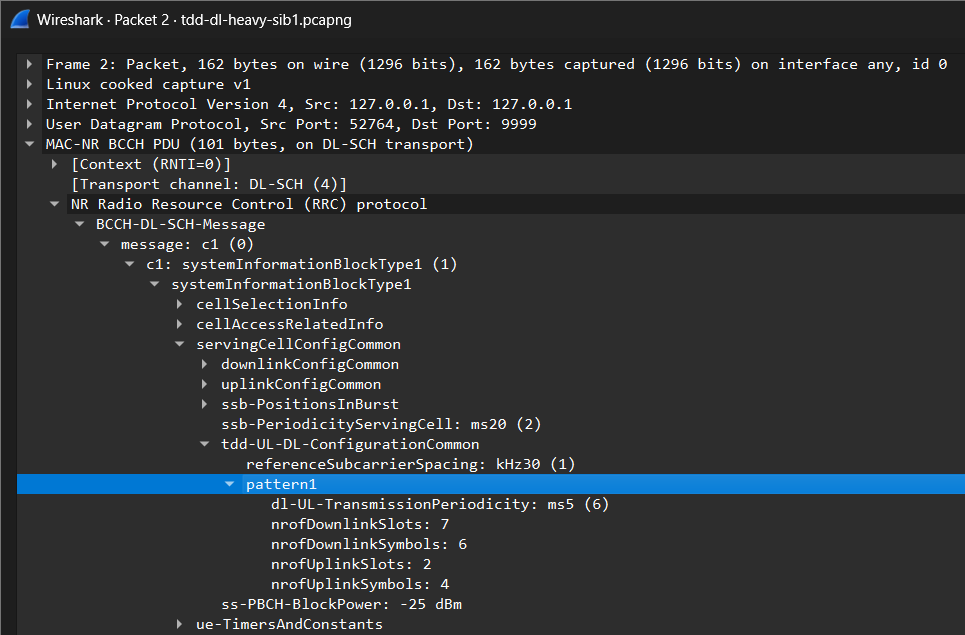

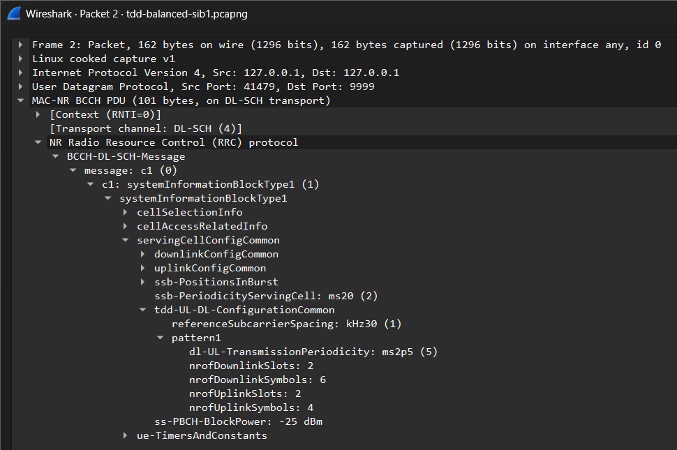


### 4.4 Draw the TDD Time Allocation

Draw one diagram for DL-heavy and one for balanced. **Use the same 0–5 ms time axis for both diagrams.** Derive each repeating period from SIB1 and repeat the shorter pattern as needed to fill the 5 ms interval. Mark every repeating-period boundary.

A spreadsheet, a drawing tool, or a hand-drawn diagram is acceptable. Include the diagrams as images in your report.

For the normal cyclic prefix used in this exercise, each reference slot contains **14 OFDM symbols**, numbered **0–13**. Use the SIB1 **reference SCS** to construct the common pattern:

| Reference SCS | Reference slot duration |
| --- | ---: |
| 15 kHz | 1 ms |
| 30 kHz | 0.5 ms |
| 60 kHz | 0.25 ms |
| 120 kHz | 0.125 ms |

```text
Number of reference slots in a pattern = Pattern period ÷ Reference slot duration
```

For each pattern:

1. Place `nrofDownlinkSlots` full DL slots at the beginning.
2. If `nrofDownlinkSymbols` is nonzero, mark that many symbols at the beginning of the next slot as DL.
3. Place `nrofUplinkSlots` full UL slots at the end.
4. If `nrofUplinkSymbols` is nonzero, mark that many symbols at the end of the slot immediately before the full UL slots as UL. If there are no full UL slots, use the last slot of the pattern.
5. Mark all remaining symbols as **F (flexible)**. The partial DL and partial UL portions may be in the same slot or in different slots.

Use **D = downlink**, **U = uplink**, and **F = flexible**. Include a legend, the common 0–5 ms time scale, slot indices, and repeating-period boundaries. You may restart the local slot index at zero at each period boundary, but label the boundaries clearly. Expand any mixed slot to show all 14 symbols. Do not automatically label flexible symbols as UL or guard time.

If `pattern2` is present, draw `pattern1` followed by `pattern2`; the combined sequence repeats. Label each pattern boundary and show the full combined duration.

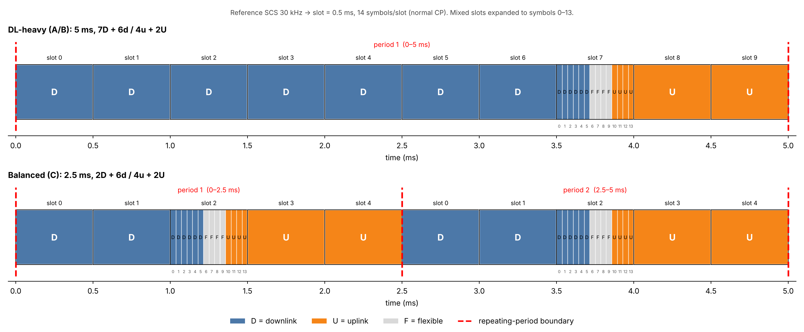

First, count the symbols over **one complete repeating sequence** for each configuration. The two sequences may have different durations, so their raw UL symbol counts alone cannot be used to compare resources per unit time:

```text
Configured DL symbols = 14 × Full DL slots + Partial DL symbols
Configured UL symbols = 14 × Full UL slots + Partial UL symbols
Flexible symbols = Total symbols - Configured DL symbols - Configured UL symbols
Configured UL symbol share (%) = Configured UL symbols ÷ Total symbols × 100
```

For two patterns, sum the counts and durations of both patterns before calculating the share. These are symbol-count shares of the common configuration, not exact airtime measurements or measured throughput shares.

| TDD setting | Repeating duration (ms) | Total reference slots | DL symbols | UL symbols | Flexible symbols | Configured UL symbol share (%) |
| --- | ---: | ---: | ---: | ---: | ---: | ---: |
| DL-heavy |5|10|104|32|4|22.86|
| Balanced |2.5|5|34|32|4|45.71|

Next, count the symbols over the **same 5 ms interval** shown in your diagrams. Multiply each per-sequence count by the number of complete repetitions in 5 ms. For these captures, 5 ms contains a whole number of repetitions for both configurations.

| TDD setting | Repeating duration (ms) | Repetitions in 5 ms | DL symbols in 5 ms | UL symbols in 5 ms | Flexible symbols in 5 ms |
| --- | ---: | ---: | ---: | ---: | ---: |
| DL-heavy |5|1|104|32|4|
| Balanced |2.5|2|68|64|8|

**Question:** Can two patterns have the same UL symbol count per period but provide different numbers of UL symbols per unit time? Explain using your two tables.

> Ans : Yes. Both configurations have 32 UL symbols per repeating period (Table 1), but DL-heavy repeats every 5 ms and balanced every 2.5 ms. Over the same 5 ms (Table 2), balanced repeats twice and provides 64 UL symbols, while DL-heavy provides only 32. The UL symbol share shows the same thing: 45.71% versus 22.86%. Raw per-period counts can’t be compared directly; they must be normalized to the same time interval.

### 4.5 Connect SIB1 to the Performance Results

Use the supplied mapping between the reference configuration captures and scenarios. Complete this table using Tasks 1–3 and your SIB1 analysis:

| Scenario | Reference TDD setting | JSON traffic direction | Configured UL symbol share (%) | Throughput (Mbps) | Packet loss (%) |
| --- | --- | --- | ---: | ---: | ---: |
| A | DL-heavy |Downlink (reverse : 1)|22.86|90.65|0.44|
| B | DL-heavy |Uplink (reverse : 0)|22.86|109.12|0.24|
| C | Balanced |Uplink (reverse : 0)|45.71|124.42|2.13|

Answer:

1. Which decoded TDD parameters differ between DL-heavy and balanced?

> Ans : Only two parameters differ:
> dl-UL-TransmissionPeriodicity: 5 ms (DL-heavy) vs 2.5 ms (balanced)
> nrofDownlinkSlots: 7 vs 2
> The other fields are identical in both captures: referenceSubcarrierSpacing (30 kHz), nrofDownlinkSymbols (6), nrofUplinkSlots (2) and nrofUplinkSymbols (4). Neither capture contains pattern2.
2. Which configuration provides more configured UL symbols per unit time? Support your answer with the diagram and calculated share.
> Ans : The balanced configuration does. In the 0–5 ms diagram, balanced repeats twice, giving four full UL slots plus two partial UL portions. DL-heavy has only two full UL slots plus one partial UL portion. That is 64 versus 32 configured UL symbols in 5 ms. The configured UL symbol share is 45.71% for balanced and 22.86% for DL-heavy, so balanced offers twice the UL share.
3. How does that difference help explain the B/C throughput comparison?
> Ans : B and C both carry uplink traffic, and C’s balanced configuration provides twice as many configured UL symbols per unit time, giving the scheduler more uplink opportunities. This is consistent with C’s higher throughput (124.42 vs 109.12 Mbps). However, the gain (+14%) is much smaller than the resource increase (+100%), and loss rose to 2.13%, so scheduling, radio conditions, overhead and offered load also matter. SIB1 shows only the configured pattern, and the configuration captures were recorded separately, so this is a plausible explanation, not proof of the only cause.
4. Why can A and B use the same SIB1 TDD configuration even though their traffic directions differ?
> Ans : The TDD configuration in SIB1 is a cell-wide setting broadcast by the gNB, so it applies to every UE regardless of which direction a test sends traffic. The iperf3 direction is chosen by the application (reverse: 1 for A, reverse: 0 for B), so A uses the DL portion of the same pattern (about 74% of symbols) and B uses its UL portion (22.86%). Keeping the configuration fixed allows a fair comparison of the two directions.

> More configured UL resources can provide more opportunities for uplink traffic, but they do not guarantee a proportional throughput increase. Scheduling, radio conditions, overhead, offered traffic, and other radio settings also affect the result. This comparison does not establish that the TDD pattern is the only cause of a performance difference. SIB1 does not show actual slot-by-slot data scheduling. Because the configuration captures were recorded separately, use them as references for the supplied settings, not as independent proof of what was broadcast during each original performance run.

### Optional Observation — PRACH Configuration Index

In the same SIB1, find:

```text
servingCellConfigCommon
  → uplinkConfigCommon
    → initialUplinkBWP
      → rach-ConfigCommon
        → setup
          → rach-ConfigGeneric
            → prach-ConfigurationIndex
```

Wireshark may omit or display the `setup` layer differently. You can also use this display filter, then confirm the field is inside SIB1:

```text
nr-rrc.prach_ConfigurationIndex
```

| TDD setting | SIB1 packet number | PRACH configuration index |
| --- | ---: | ---: |
| DL-heavy |2|98|
| Balanced |2|98|

PRACH is used to send a random-access preamble. Its configuration index is not the DL/UL slot ratio and does not directly explain iperf3 throughput. Equal indices in the two configurations are a valid observation. Drawing PRACH occasions requires additional parameters and the applicable TS 38.211 table; it is outside the required TDD drawing task.
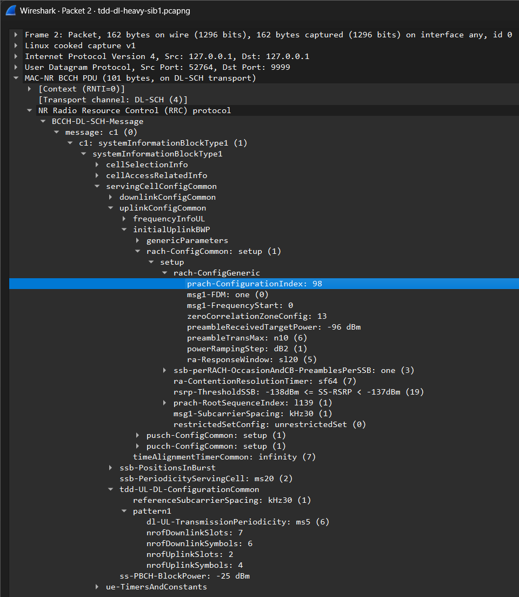
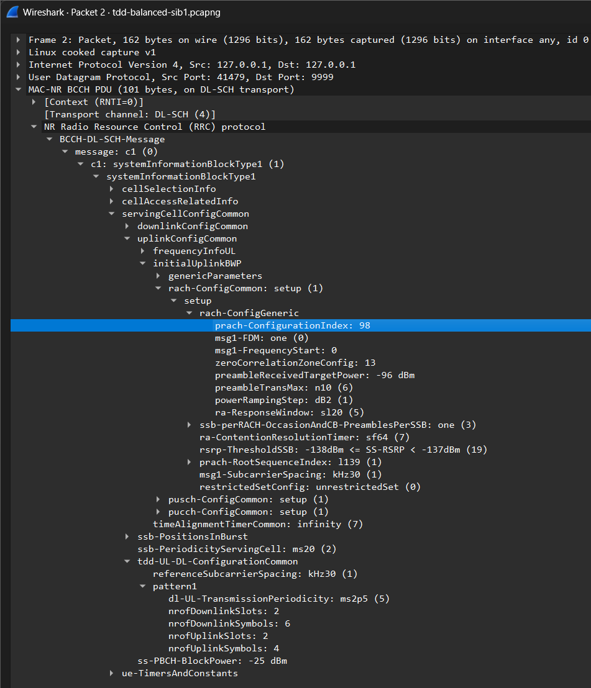


## 7. Task 5 — Is the TDD Setting Suitable?

Complete the table using the supplied scenario mapping, the SIB1 reference configurations from Task 4, and your throughput results:

| Scenario | TDD setting | Traffic direction | Is the setting suitable for this direction? Why? |
| --- | --- | --- | --- |
| A | DL-heavy | Downlink |Yes, most configured symbols are DL: 104 of 140 (74.29%) per 5 ms period, in 7 full DL slots plus 6 DL symbols. This gives downlink traffic the most transmission opportunities. Measured DL throughput was 90.65 Mbps with low loss (0.44%).|
| B | DL-heavy | Uplink |No, only 32 of 140 symbols (22.86%) are configured as UL, in 2 full UL slots plus 4 UL symbols per 5 ms. This limits uplink transmission opportunities for heavy uplink traffic. B achieved 109.12 Mbps, lower than C under the same traffic direction.|
| C | Balanced | Uplink |Yes, 32 of 70 symbols (45.71%) are UL. Because the 2.5 ms pattern repeats twice in 5 ms, there are 64 UL symbols in 5 ms, double the DL-heavy setting. C reached 124.42 Mbps, the highest uplink throughput, though with higher loss (2.13%).|

Use these ideas:

- More DL resources provide more downlink transmission opportunities.
- More UL resources provide more uplink transmission opportunities.
- A DL-heavy setting is suitable for downlink traffic.
- A DL-heavy setting may limit heavy uplink traffic.
- A balanced setting gives uplink traffic more opportunities than the DL-heavy setting in this lab.

> The configuration captures show the reference broadcast TDD settings. The iperf3 JSON reports performance; it does not contain TDD parameters. The scenario captures are used for traffic analysis and need not include SIB1.

**Question:** Why might Scenario C achieve better uplink throughput than Scenario B? Refer to your SIB1 diagrams and measured results.

> Ans : In the 0–5 ms diagrams, DL-heavy has one UL region (slots 8–9 plus 4 UL symbols in slot 7), while balanced repeats every 2.5 ms and has two. That gives 64 configured UL symbols in 5 ms for C versus 32 for B (45.71% vs 22.86%), with UL opportunities twice as often. More UL opportunities let the UE send more data per unit time, which is consistent with C’s 124.42 Mbps versus B’s 109.12 Mbps. The gain is only about 14% and C’s loss is higher (2.13%), so the TDD pattern is a likely contributor but not proven to be the only cause.

## 8. Task 6 — Find GTP-U Information

Open a **scenario capture** in Wireshark and enter this display filter:

```text
gtp && ip
```

Choose a packet that contains two IPv4 headers. In the packet details, expand:

1. the first `Internet Protocol Version 4` header;
2. `User Datagram Protocol`;
3. `GPRS Tunneling Protocol`; and
4. the second `Internet Protocol Version 4` header.

Record the following information from one packet:

| Item | Value |
| --- | --- |
| Scenario capture filename |scenario-a-dl-heavy-downlink.pcapng|
| Packet number |1888|
| Outer source IP |192.168.70.134|
| Outer destination IP |192.168.70.129|
| Inner source IP |192.168.70.135|
| Inner destination IP |10.0.0.6|
| TEID |0xcddc4529 (3453764905)|

Meaning:

- **Outer IP addresses:** The GTP-U tunnel endpoints.
- **Inner IP addresses:** The original UE/application packet.
- **TEID:** Identifies the GTP-U tunnel at the receiving endpoint.

Take one screenshot showing the selected packet and these fields.
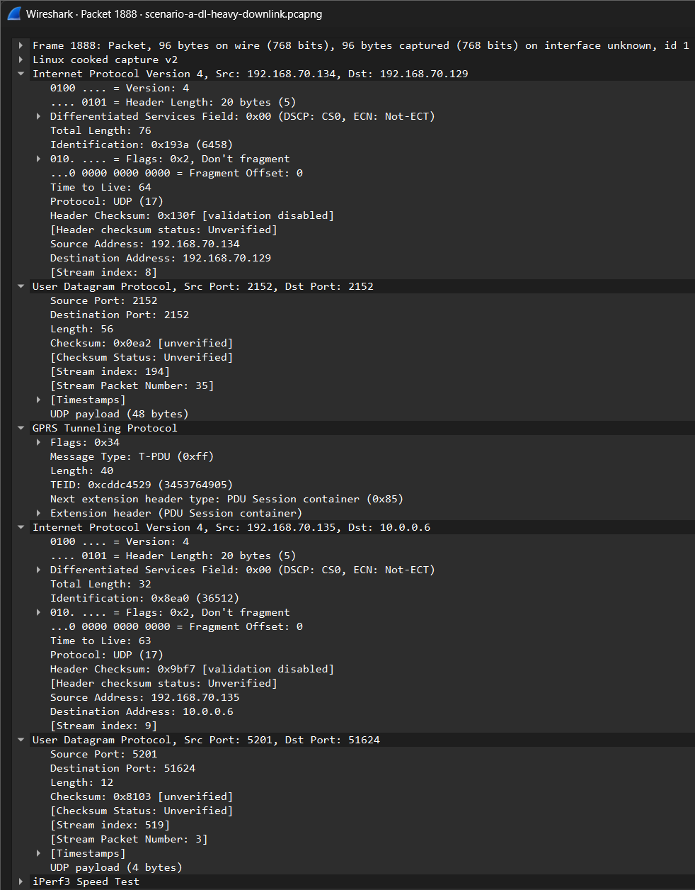

> Some GTP packets are echo or control-related packets. Select one that contains an inner IPv4 packet.

## 9. Task 7 — TCP Retransmissions

Use the **scenario captures** for this task.

The performance traffic is UDP, but iperf3 also uses a small TCP control connection.

Apply this Wireshark filter:

```text
tcp.analysis.retransmission
```

Record the number of displayed packets:

| Scenario | Displayed TCP retransmissions |
| --- | ---: |
| A |14|
| B |12|
| C |12|

> Report the number displayed by Wireshark using the specified filter. Counts may vary with Wireshark analysis settings. Include screenshots showing the filter and displayed count for each scenario. The filter includes any TCP flows that Wireshark can decode in the capture; a displayed retransmission is not, by itself, proof of loss in the UDP test.

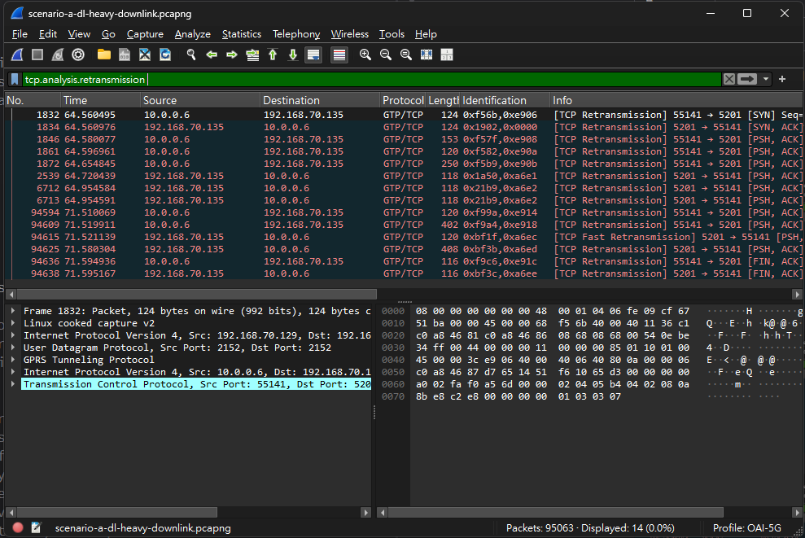

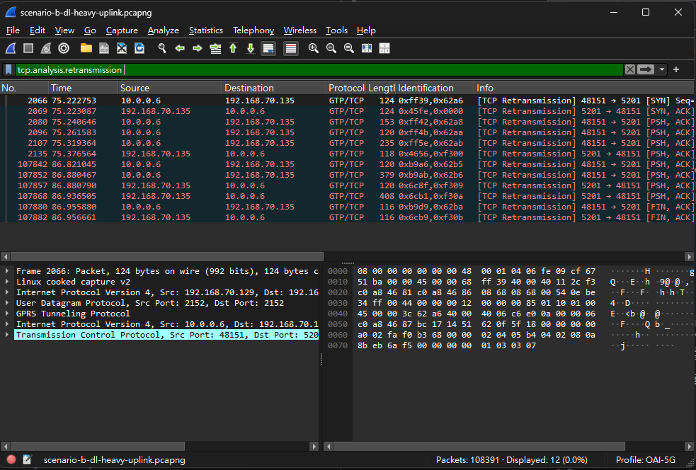

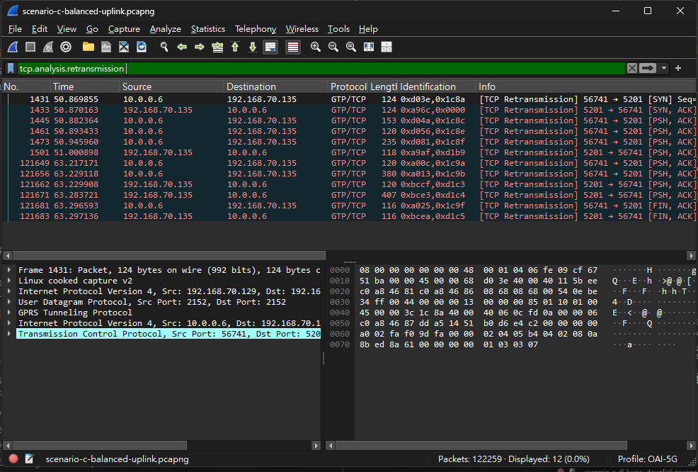


**Question:** Do these TCP retransmissions directly represent lost UDP performance packets?

> Ans : No. The iperf3 test data is UDP, which is never retransmitted, so this filter can only match TCP segments. All displayed packets (14, 12, 12) belong to the iperf3 TCP control connection to port 5201. They are also most likely duplicate captures, not real resends: almost every control segment is flagged, the copies arrive less than 1 ms apart, and frame 1832 has the same outer and inner IP IDs (0xf56b, 0xe906) as frame 1831. The counts also don’t track the UDP loss in the JSON (B and C both show 12, but C’s loss is 2.13% vs 0.24%), so UDP loss should be taken from lost_packets and lost_percent.

## 10. Task 8 — RTT and Packet Interval

Use a **scenario capture** for both parts of this task.

### TCP RTT

Apply:

```text
tcp.analysis.ack_rtt
```

Select one packet from the iperf3 TCP control connection and record its ACK RTT:

| Scenario | Packet number | Example TCP ACK RTT |
| --- | ---: | --- |
| C |1441|11.405ms|

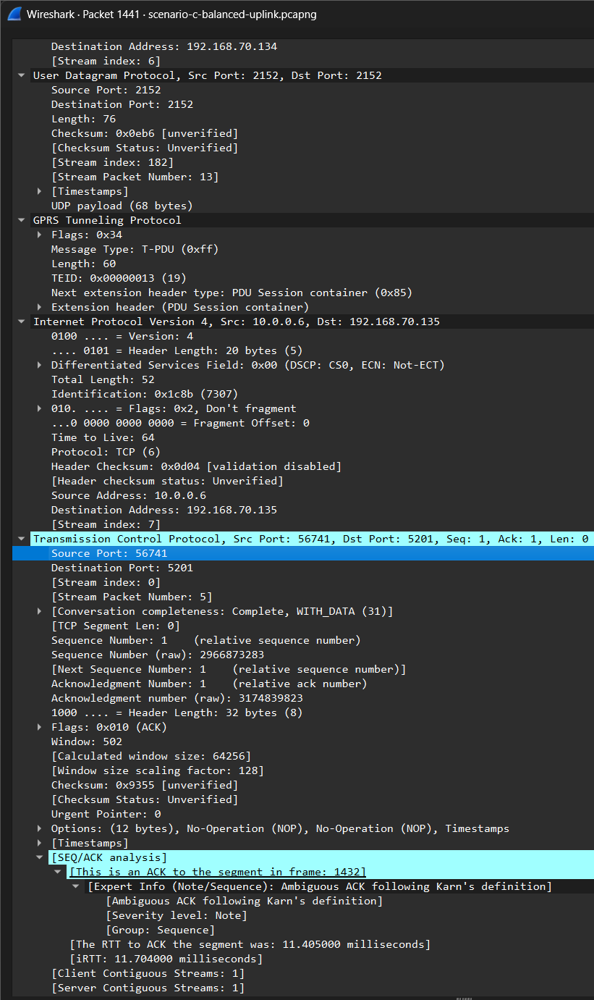

This value is the RTT of the TCP control connection. It is not the RTT of the UDP data packets.

### Packet Interval

Apply a display filter to select UDP data packets from the same flow.

Select two consecutive, distinct UDP data packets in the filtered packet list. Avoid duplicated observations caused by merged captures; use the same capture point/interface when possible.

In the packet details of the second packet, find:

```text
Time delta from previous displayed frame
```

Record the scenario, display filter, packet numbers, and time interval.

| Scenario | Display filter | Packet numbers | Time interval |
| --- | --- | --- | --- |
|C|ip.src == 192.168.70.129 && ip.dst == 192.168.70.134 && frame.len > 1000|78751, 78753|0.000039 s|

> Each data packet appears twice in the capture. 78752 has the same IP ID (0x5551) as 78751, 4 µs later, so it is a duplicate. 78751 (ID 0x5551) and 78753 (ID 0x5552) are two consecutive distinct packets. The interval is 59.206653 − 59.206614 s = 39 µs. The displayed delta of 78753 (35 µs) is measured from the duplicate 78752, so it was not used.

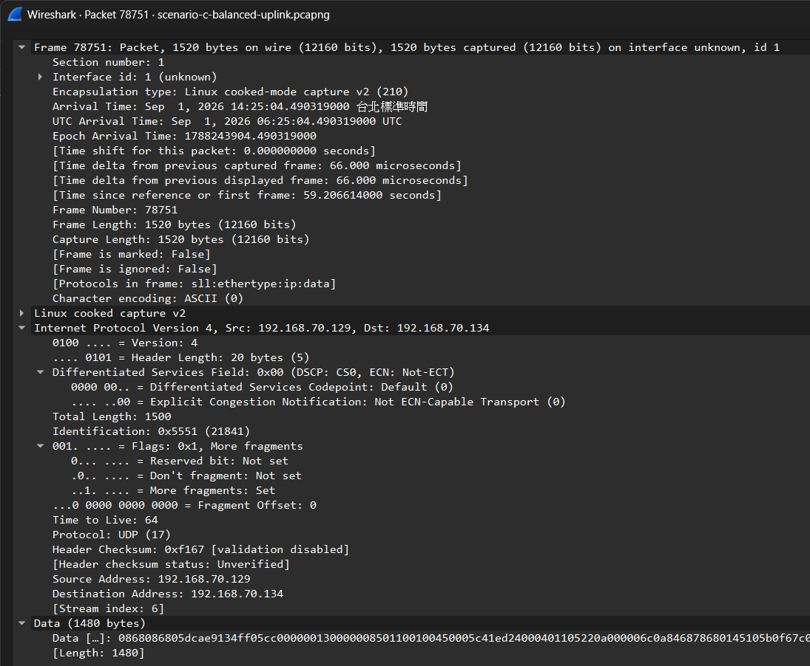
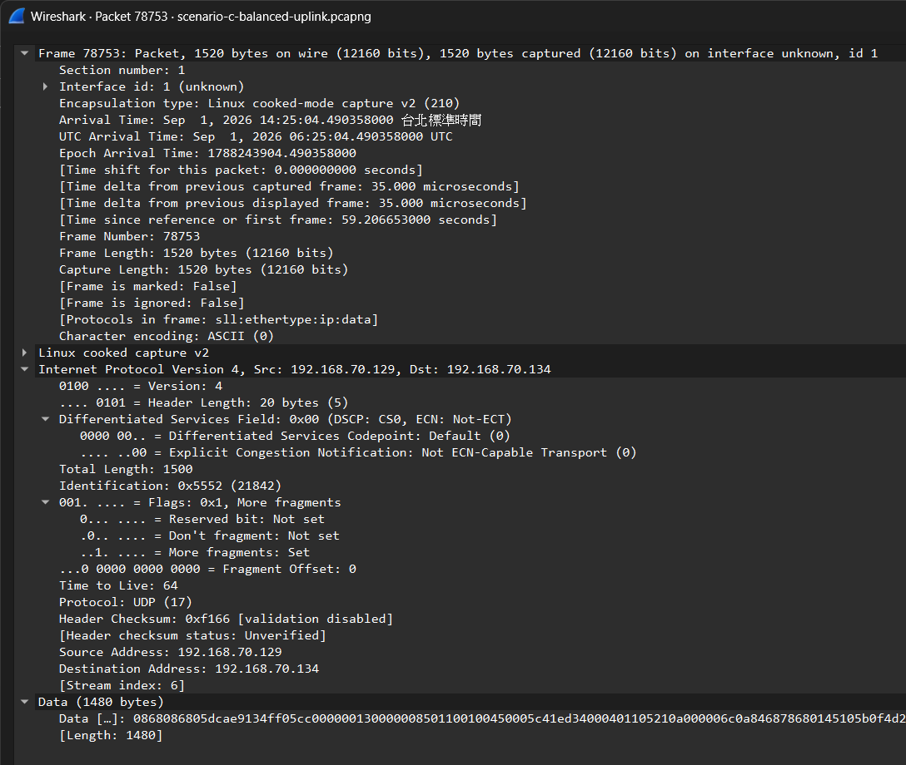

**Note:** The time interval depends on the applied display filter. Make sure the selected packets are distinct data packets, not duplicated observations from different capture points. Do not use their interval to infer the TDD slot pattern.

## 11. Final Questions

Answer each question in two or three sentences:

1. Does Scenario A use a TDD setting that matches its traffic direction?
> Ans : Yes. Scenario A sends downlink traffic (reverse: 1) and uses the DL-heavy reference configuration, where 104 of 140 configured symbols per 5 ms period (74.29%) are DL. This setting gives downlink traffic the most transmission opportunities, so it matches A’s traffic direction.
2. Why is Scenario B expected to have limited uplink resources? Cite a parameter or count from the DL-heavy SIB1 reference configuration.
> Ans : In the DL-heavy SIB1, nrofDownlinkSlots is 7 out of 10 slots per 5 ms period, while only 2 full UL slots plus 4 UL symbols are configured. That gives 32 UL symbols out of 140, a configured UL symbol share of only 22.86%. Uplink traffic in B therefore has relatively few scheduling opportunities.
3. How much does uplink throughput change from B to C?
> Ans : Uplink throughput rises from 109.12 Mbps in B to 124.42 Mbps in C, an increase of about 15.30 Mbps, or 14.0%. This is consistent with C’s balanced configuration providing twice as many configured UL symbols per unit time (64 vs 32 in 5 ms).
4. What negative result, if any, is visible in C? Support your answer with packet loss or jitter values.
> Ans : C shows higher packet loss: 2.13% compared with 0.24% in B, about nine times higher. Jitter also increased slightly, from 0.116 ms to 0.162 ms, but this change is very small and not significant in practice.
5. Why can increasing UL resources improve uplink throughput?
> Ans : More configured UL symbols give the gNB scheduler more opportunities to grant uplink transmissions, so the UE can send more data per unit time. In the balanced configuration, UL opportunities also occur every 2.5 ms instead of every 5 ms, which reduces how long uplink data waits for a UL slot.
6. Is adding more UL resources always the best solution? Explain using throughput and packet loss.
> Ans : No. Doubling the UL share (22.86% to 45.71%) raised throughput by only about 14%, while packet loss rose from 0.24% to 2.13%, so other factors such as scheduling, radio conditions and the offered traffic rate also limit performance. More UL resources also take symbols away from DL, which would hurt downlink-heavy traffic.
7. Suggest one simple follow-up test that could improve throughput without producing too much packet loss.
> Ans : Repeat Scenario C with a fixed UDP target rate set with iperf3 -b, stepping it up (for example 100, 110, 120 and 130 Mbps) while recording throughput and loss at each step. The highest rate that keeps loss low, for example below 1%, shows the usable uplink capacity without excessive packet loss. Running each test several times also shows whether the loss difference between B and C is consistent.
8. What can the configuration captures tell you that the iperf3 JSON cannot? Why are separately recorded configuration captures not direct proof of the configuration during an earlier test?
> Ans : The configuration captures show the gNB’s broadcast SIB1 settings, such as the TDD pattern (periodicity and DL/UL slot and symbol counts) and the PRACH configuration, which the iperf3 JSON does not contain. The JSON reports only traffic direction and application-level performance. Because the configuration captures were recorded separately from the iperf3 tests, they show what the gNB broadcast at the time of capture, not necessarily what was configured during the original runs, so they serve as references for the supplied settings rather than direct proof.

## 12. Submission Checklist

Submit one Markdown file containing:

- the completed direction table;
- the throughput table and B-to-C calculation;
- the B/C packet-loss and jitter table;
- the SIB1 TDD parameter table, including filenames and packet numbers;
- one SIB1 TDD screenshot per configuration, plus `pattern2` screenshots if needed;
- two TDD diagrams: DL-heavy and balanced, with D/U/F labels and mixed-slot symbol details;
- the per-sequence symbol-count / UL-share table, the common 5 ms comparison table, and the configuration-to-performance table;
- the Task 4.5 answers and the TDD suitability table;
- one GTP-U screenshot and its completed table;
- the TCP retransmission counts and screenshots;
- one TCP ACK RTT example;
- one packet-interval example; and
- answers to the final questions.

The PRACH observation is optional and carries no required points. Include all referenced image files alongside the Markdown file, or submit a ZIP containing the report and images.

## 13. Grading Rubric

| Item | Points |
| --- | ---: |
| Traffic direction | 5 |
| Throughput values and calculation | 20 |
| B/C packet-loss and jitter comparison | 15 |
| SIB1 TDD parameter extraction and screenshot evidence | 10 |
| TDD diagrams, symbol counts, and UL shares | 10 |
| TDD suitability and connection to measured performance | 10 |
| GTP-U fields and screenshot | 15 |
| TCP retransmission, RTT, and packet interval | 10 |
| Clear final answers | 5 |
| **Total** | **100** |

## References

These references support the field names and interpretation. Reading the full specifications is not required.

- [Wireshark NR RRC display filter reference](https://www.wireshark.org/docs/dfref/n/nr-rrc.html): SIB1 and TDD display-filter fields.
- [3GPP TS 38.331, Release 18](https://www.etsi.org/deliver/etsi_ts/138300_138399/138331/18.08.00_60/ts_138331v180800p.pdf): SIB1, TDD-UL-DL-ConfigCommon, and TDD-UL-DL-Pattern definitions.
- [3GPP TS 38.213, Release 17, Section 11.1](https://www.etsi.org/deliver/etsi_ts/138200_138299/138213/17.06.00_60/ts_138213v170600p.pdf): Interpretation of common TDD slot and symbol allocation.