# Lab 3: Deploying a 5G Standalone Network Using OpenAirInterface

## 1. Goal

In the previous labs, you analyzed 5G signaling messages and network performance using provided captures and measurements.

In this lab, you will deploy your own 5G Standalone (SA) network using OpenAirInterface (OAI), verify the complete connection, investigate RFsimulator communication, perform active network measurements, and troubleshoot a controlled connection failure.

Unlike the previous labs, you will collect measurements directly from your own running 5G network.

**Learning Objectives**

After completing this lab, you should be able to:

1. Deploy an OAI gNB, nrUE, and 5G Core Network.
2. Identify the main stages of 5G SA connection establishment.
3. Verify communication between gNB and nrUE through RFsimulator.
4. Measure user-plane connectivity under different packet sizes.
5. Diagnose connection failures using OAI and 5GC logs.
6. Explain the limitations of a software-simulated 5G network.

## 2. Experimental Environment

Use the *OAI v2.4.0 Build Guide* to prepare the environment before class.

| Component | Configuration |
|---|---|
| Ubuntu | 24.04 |
| OAI RAN | v2.4.0 |
| 5G Core | OAI CN5G |
| gNB | nr-softmodem |
| UE | nr-uesoftmodem |
| Radio interface | RFsimulator |
| Band | n78 |
| Subcarrier spacing | 30 kHz |
| Resource blocks | 106 |
| UE IMSI | 001010000000001 |
| External DN | 192.168.70.135 |

The experiment uses one Ubuntu machine without physical RF hardware.

## 3. Task 1 — Deploy and Verify the Complete 5G SA Network

Start the OAI CN5G:

```bash
cd ~/oai-cn5g
docker compose up -d
docker compose ps
```

Start the gNB and nrUE using the commands in the Build Guide.

Observe their terminal outputs and locate evidence of the following stages.

| Stage | Successful? | Evidence from logs |
|---|---|---|
| CN5G initialization |Successful|All 11 containers `(healthy)`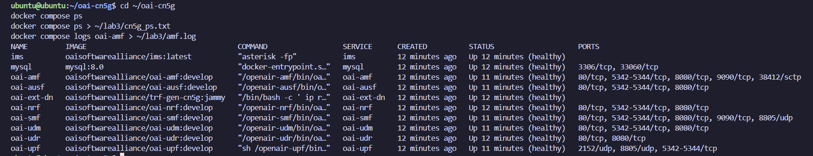|
| gNB NG Setup |Successful|gnb.log:76 `Send NGSetupRequest` → :86 `Received NGSetupResponse`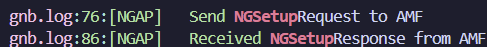|
| UE synchronization |Successful|ue_ok.log:78 `Initial sync successful, PCI: 0`; :81 `UE synchronized!`; :84 `SIB1 decoded`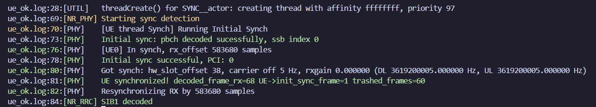|
| RRC connection establishment |Successful|gnb.log:215 `RRC_CONNECTED reached`; ue_ok.log:99, :104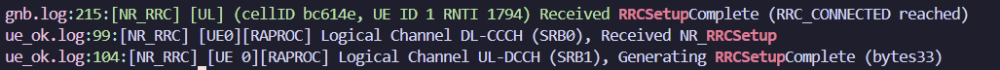|
| UE Registration |Successful|ue_ok.log:157 `Received Registration Accept`; AMF `5GMM-REGISTERED`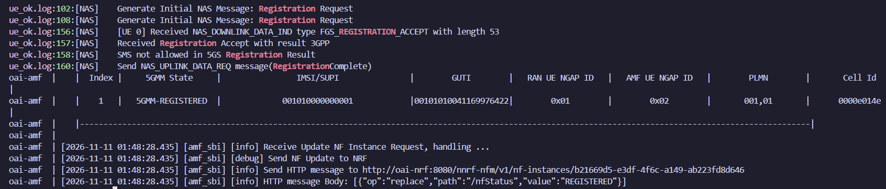|
| PDU Session Establishment |Successful|ue_ok.log:175 `PDU Session Establishment Accept, UE IPv4: 10.0.0.2`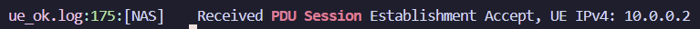|
| UE tunnel creation |Successful|ue_ok.log:177 `oaitun_ue1 successfully configured`; `inet 10.0.0.2/24`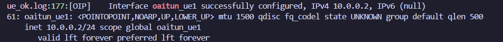|

Take screenshots showing the gNB and UE successfully connected.
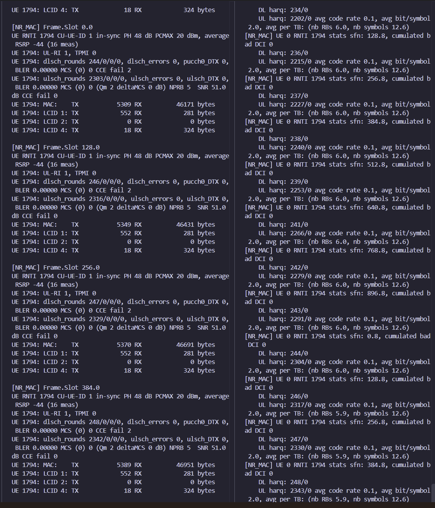


**Questions:**

1. Does a successful NG Setup guarantee that a UE can register? Explain.
> Ans: No. NG Setup only creates the N2 association between the gNB and the AMF (gnb.log:76, 86) and involves no UE. Registration additionally needs radio sync, RRC setup, and successful NAS authentication of a provisioned subscriber through AUSF/UDM/UDR. In our run, registration succeeded separately later (ue_ok.log:157).
2. Why can the UE establish an RRC connection but still fail Registration?
> Ans: RRC is an Access Stratum procedure between the UE and gNB, and the gNB accepts any UE without checking its identity. Registration is a NAS procedure with the AMF, where the subscriber is authenticated. It can fail if, for example, the IMSI is not provisioned, the keys are wrong, or the PLMN/slice is not allowed — exactly what Task 5 shows.
3. What additional procedure is required after Registration before user data can be exchanged?

>Ans: A PDU Session Establishment. The SMF selects a UPF and allocates the UE IP, the gNB sets up a data radio bearer, and a GTP-U tunnel is built between gNB and UPF. In our logs this is ue_ok.log:175 (`PDU Session Establishment Accept, UE IPv4: 10.0.0.2`) followed by :177 (`oaitun_ue1 successfully configured`).

## 4. Task 2 — Investigate RFsimulator Communication

OAI RFsimulator replaces the physical RF interface with software-based communication.

The gNB and nrUE exchange IQ samples through a TCP connection.

Check the running processes:

```bash
pgrep -a nr-softmodem
pgrep -a nr-uesoftmodem
```

Inspect the TCP connections:

```bash
sudo ss -tnp | grep 4043
```

If necessary, inspect the listener:

```bash
sudo ss -ltnp | grep 4043
```

The default RFsimulator port in this experiment is 4043.

Complete the table:

| Item | Observed Value |
|---|---|
| gNB process ID |139400 (nr-softmodem)|
| nrUE process ID |141829 (nr-uesoftmodem)|
| RFsimulator transport protocol |TCP|
| RFsimulator port |4043 (gNB server port); UE uses ephemeral client port 41456|
| TCP connection state |ESTAB (established); gNB additionally holds a LISTEN socket on *:4043|
| Connected process(es) |nr-uesoftmodem (127.0.0.1:41456) ↔ nr-softmodem (127.0.0.1:4043)|

Take one screenshot showing the TCP connection.
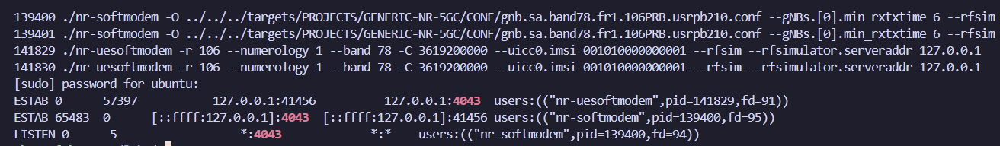


**Questions:**

1. Why does RFsimulator use a TCP connection instead of a physical antenna?
> Ans: It replaces the RF hardware and antennas with software, so the full 5G stack can run on one VM without an SDR or spectrum license. The gNB and UE write their IQ samples into a TCP socket instead of transmitting them. TCP is reliable and in order, so no samples are lost or reordered.
2. Are the TCP packets exchanged by RFsimulator the same as the UE's application-layer IP packets?
> Ans: No. The TCP stream carries baseband IQ samples, not IP packets. A ping packet is processed by PDCP/RLC/MAC/PHY and turned into IQ samples before it reaches the socket. The stream runs continuously even without user data, consistent with the large Send-Q/Recv-Q values (57397 / 65483 bytes) in our `ss` output.

3. Does using RFsimulator mean that the UE and gNB are performing no physical-layer processing? Explain.

> Ans: No. Only the RF hardware is replaced; OFDM, channel coding, modulation, synchronization, and HARQ still run in software. Our logs show this: the UE decodes PBCH (`Initial sync successful, PCI: 0`) and the gNB reports `SNR 51.0 dB`, `BLER 0.00000`, and HARQ rounds. What is missing are real RF impairments and propagation effects.

## 5. Task 3 — Verify End-to-End Connectivity

Check the UE tunnel interface:

```bash
ip -4 addr show oaitun_ue1
```

Test connectivity to the External DN:

```bash
ping -I oaitun_ue1 -c 10 192.168.70.135
```

Record:

| Measurement | Observed Value |
|---|---|
| UE IP address |10.0.0.2|
| Destination IP |192.168.70.135|
| Packets transmitted |10|
| Packets received |10|
| Packet loss (%) |0%|
| Minimum RTT (ms) |15.804|
| Average RTT (ms) |23.372|
| Maximum RTT (ms) |29.709|

Take a screenshot of the Ping result.
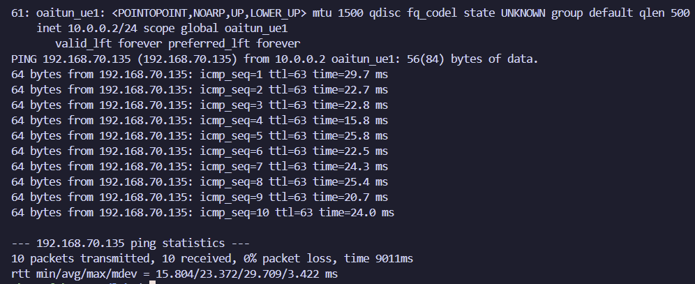


**Questions:**

1. Why must Ping use the `oaitun_ue1` interface in this experiment?

> Ans: The VM is directly connected to the Docker network (192.168.70.128/26) through the `oai-cn5g` bridge. Without `-I oaitun_ue1`, the ping would go straight to the ext-dn container and bypass the 5G system. Binding to `oaitun_ue1` forces the packet through the UE stack, the simulated radio link, the gNB, and the GTP-U tunnel to the UPF.

2. Does successful Registration guarantee successful user-plane connectivity?

> Ans: No. Registration is control-plane only. User data also needs a PDU session (IP allocation by the SMF, UPF rules, a radio bearer, and a GTP-U tunnel), and it can still fail because of DNN/slice, UPF, or routing problems. Our connectivity was confirmed only after ue_ok.log:175, :177, and a successful ping.

3. What does a successful Ping prove, and what does it not prove about the simulated 5G system?

> Ans: It proves that the full end-to-end path works in both directions and that registration, authentication, and PDU session setup succeeded (10/10 replies, average 23.372 ms). It does not prove real 5G performance: the RTT reflects software processing in a VM, the channel is ideal, and it does not test throughput, load, mobility, multiple UEs, or real RF hardware.

## 6. Task 4 — Investigate the Effect of Packet Size

You will now investigate whether changing the ICMP packet size affects the observed RTT.

Perform three experiments using the same established 5G connection.

**Scenario A — Small Packets**

```bash
ping -I oaitun_ue1 -s 56 -c 30 -i 0.2 192.168.70.135
```
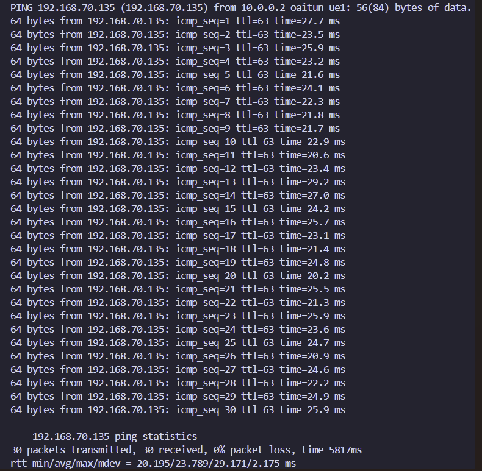

**Scenario B — Medium Packets**

```bash
ping -I oaitun_ue1 -s 512 -c 30 -i 0.2 192.168.70.135
```
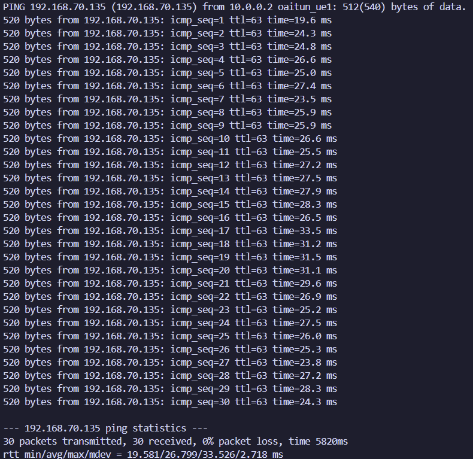

**Scenario C — Large Packets**

```bash
ping -I oaitun_ue1 -s 1200 -c 30 -i 0.2 192.168.70.135
```
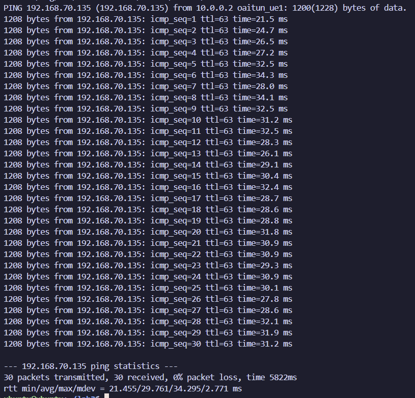

Note: `-s` specifies ICMP payload size, not the complete IP packet size.

Complete the table:

| Scenario | ICMP Payload | Avg. RTT (ms) | Max. RTT (ms) | Packet Loss (%) |
|---|---:|---:|---:|---:|
| A | 56 bytes |23.789|29.171|0%|
| B | 512 bytes |26.799|33.526|0%|
| C | 1200 bytes |29.761|34.295|0%|

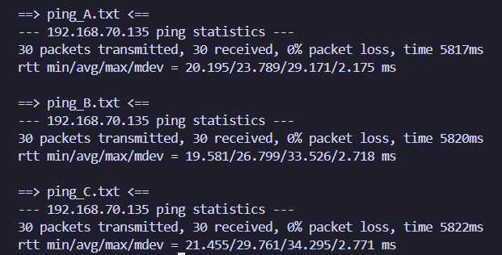

Calculate the RTT difference:

```text
RTT Difference = Average RTT(C) - Average RTT(A)
```

RTT Difference = Average RTT(C) − Average RTT(A) = 29.761 − 23.789 = 5.972 ms

---

**Repeated run (run 2):**

| Scenario | ICMP Payload | Avg. RTT (ms) | Max. RTT (ms) | Packet Loss (%) |
|---|---:|---:|---:|---:|
| A | 56 bytes | 22.505 | 25.106 | 0% |
| B | 512 bytes | 22.668 | 26.793 | 0% |
| C | 1200 bytes | 26.579 | 36.017 | 0% |

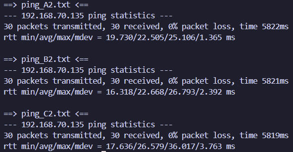

RTT Difference (run 2) = 26.579 − 22.505 = 4.074 ms; average over both runs = 5.023 ms

---

**Questions:**

1. Which scenario has the highest average RTT?
> Ans: Scenario C (1200-byte payload, 1228-byte IP packet) has the highest average RTT in both runs: 29.761 ms in run 1 and 26.579 ms in run 2. C also has the highest maximum RTT in both runs (34.295 ms and 36.017 ms). Scenario A has the lowest average RTT in both runs (23.789 ms and 22.505 ms). The RTT difference between C and A is 5.972 ms in run 1 and 4.074 ms in run 2, or 5.023 ms on average.
2. Does increasing packet size always increase RTT in your measurements?
> Ans: Not consistently. Run 1 increases monotonically (23.789 < 26.799 < 29.761 ms), but in run 2 B is only 0.163 ms above A, within the measurement deviation. B itself varied by 4.1 ms between runs, so large packets clearly add about 4–6 ms, while the effect of medium packets is smaller than the normal variation.

3. Why might a larger packet require more transmission or processing resources?
> Ans: More bits must be sent, so the scheduler needs more resource blocks or slots, and the uplink may need a Scheduling Request and Buffer Status Report before a large enough grant is given (our idle uplink used only `NPRB 5`, `MCS 0`). Ciphering, segmentation, LDPC coding, and GTP-U encapsulation also scale with data size, all on the same CPU.

4. What factors other than packet size could affect RTT in a software-based 5G network?
> Ans: 
> * CPU load and VM scheduling. The gNB, UE, and all core-network containers share the same VM and that VM may share the Proxmox host with other workloads. Any contention delays the real-time processing threads.
> * TDD frame structure. Uplink and downlink can only be sent in their assigned slots, so a packet may have to wait for the next uplink or downlink slot.
> * Scheduling procedures. The periodicity of Scheduling Requests and the timing of uplink grants and HARQ feedback (for example, the min_rxtxtime 6 setting used in our gNB command) add delay.
> * HARQ retransmissions. These would add delay, although our logs showed 0 errors.
> * RFsimulator pacing. RFsimulator paces the IQ sample exchange to emulate the radio timeline.
> * Logging and terminal output. The gNB and UE print statistics continuously, and we also write the logs to files with tee.
> * Core-network path. Processing in the UPF, Docker networking, and the ext-dn container also contribute.
> 
> The large variation we observed suggests that these factors matter: with the same 56-byte payload and no configuration change, the average RTT ranged from 22.505 ms to 28.545 ms across runs, and the 512-byte scenario varied by 4.1 ms between two consecutive runs.
5. Can these results be interpreted as real over-the-air 5G latency? Explain.
> Ans: No. The RTT reflects software processing on a shared VM, while the channel is ideal (SNR 51 dB, BLER 0, 0% loss) with no propagation delay, RF latency, fading, or retransmissions. The results are useful for relative comparison in this environment, not as real 5G air-interface latency.

Do not assume that RTT must increase with packet size. Use your measured values to support your explanation.

## 7. Task 5 — Diagnose a Controlled UE Registration Failure

In this task, you will deliberately introduce one configuration error and investigate why the UE cannot complete registration.

**Important:** Save the original successful UE command before starting. Do not modify the CN5G subscriber database.

### Step 1 — Stop the UE

Press `Ctrl+C` in the nrUE terminal. Keep the CN5G and gNB running.

### Step 2 — Launch the UE with an Incorrect IMSI

Change only the IMSI:

```bash
sudo ./nr-uesoftmodem \
  -r 106 \
  --numerology 1 \
  --band 78 \
  -C 3619200000 \
  --uicc0.imsi 001010000000099 \
  --rfsim \
  --rfsimulator.serveraddr 127.0.0.1
```

The IMSI `001010000000099` is not provisioned in the standard classroom subscriber configuration. Verify this assumption against the instructor's database before class.

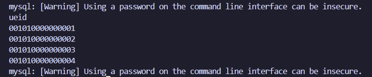

Figure 5-1. Subscriber database query. Only IMSIs `001010000000001`–`001010000000004` are provisioned in `AuthenticationSubscription`. The second query (`WHERE ueid='001010000000099'`) returned no rows, confirming that the test IMSI is not provisioned.

Observe the UE and AMF logs.

```bash
cd ~/oai-cn5g
docker compose logs --since=2m oai-amf
```

Allow time for registration attempts, then stop the UE.

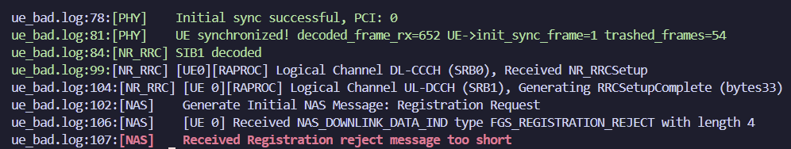

Figure 5-2. UE log with IMSI `001010000000099`. The UE synchronizes, completes RRC setup, and sends a Registration Request, but receives `FGS_REGISTRATION_REJECT`. The UE could not decode the reject cause (`message too short`).

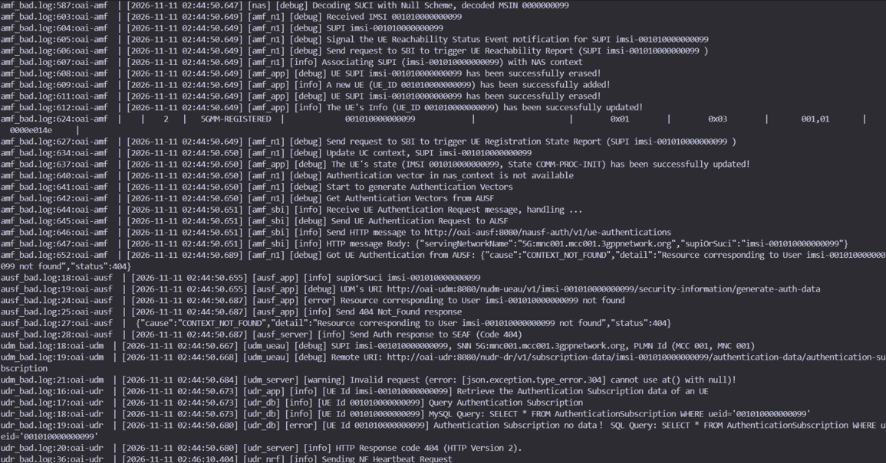

Figure 5-3. Core-network logs showing the authentication failure chain: AMF → AUSF → UDM → UDR. The UDR finds no `AuthenticationSubscription` record for `001010000000099` and returns 404, which propagates back to the AMF as `CONTEXT_NOT_FOUND`. Line 624 is a transient entry printed when the AMF creates the UE context before authentication; line 637 shows the actual state `COMM-PROC-INIT`, and the final AMF table shows `5GMM-DEREGISTERED` with no GUTI (Figure 5-4).

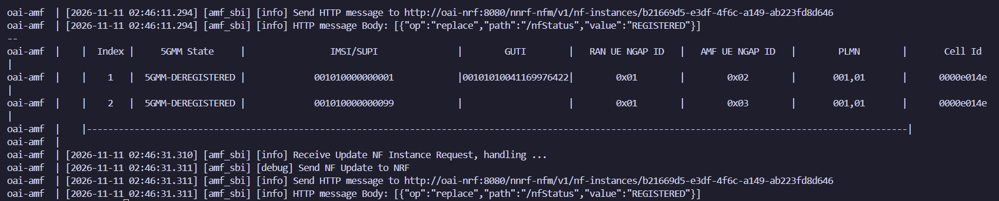

Figure 5-4. AMF UE context table after the failed attempt. IMSI `001010000000099` is `5GMM-DEREGISTERED` with no GUTI, meaning the AMF never completed its registration. IMSI `001010000000001` also shows DEREGISTERED only because that UE had been stopped before the test; it keeps the GUTI from its earlier successful registration.

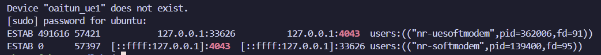

Figure 5-5. During the failed attempt, `oaitun_ue1` does not exist, but the RFsimulator TCP connection between `nr-uesoftmodem` (PID 362006) and `nr-softmodem` (PID 139400, port 4043) remains `ESTAB`.

Complete the table:

| Item | Observation |
|---|---|
| Modified parameter | `--uicc0.imsi` changed from `001010000000001` to `001010000000099` (all other parameters unchanged) |
| UE synchronized with gNB? | **Yes.** ue_bad.log:78 `Initial sync successful, PCI: 0`; :81 `UE synchronized!`; :84 `SIB1 decoded` (Fig. 5-2) |
| RRC connection established? | **Yes.** ue_bad.log:99 `Received NR_RRCSetup`; :104 `Generating RRCSetupComplete` (Fig. 5-2) |
| Registration successful? | **No.** The UE received `FGS_REGISTRATION_REJECT` (ue_bad.log:106). The AMF table shows IMSI `001010000000099` as `5GMM-DEREGISTERED` with no GUTI. No PDU session was set up and `oaitun_ue1` does not exist (Fig. 5-2, 5-4, 5-5) |
| Error or rejection evidence | **UE:** `Received NAS_DOWNLINK_DATA_IND type FGS_REGISTRATION_REJECT with length 4` and `Received Registration reject message too short` (ue_bad.log:106–107; the UE could not decode the cause value). **UDR:** `Authentication Subscription no data! SQL Query: SELECT * FROM AuthenticationSubscription WHERE ueid='001010000000099'` → `HTTP Response code 404` (udr_bad.log:19–20). **AUSF:** `Resource corresponding to User imsi-001010000000099 not found` → `Send 404 Not_Found` (ausf_bad.log:24–28). **AMF:** `Got UE Authentication from AUSF: {"cause":"CONTEXT_NOT_FOUND", ... "status":404}` (amf_bad.log:652) (Fig. 5-3) |
| Likely cause | IMSI `001010000000099` is not provisioned in the subscriber database (the `AuthenticationSubscription` table only contains `...001`–`...004`, Fig. 5-1). Without a subscription record, the UDM cannot generate authentication vectors, so the AUSF returns 404, the AMF cannot authenticate the UE, and it rejects the registration. |

If the expected registration rejection does not appear, report the actual logs instead of inventing a failure message.

### Step 3 — Restore the Original IMSI

Restart the nrUE using:

```text
--uicc0.imsi 001010000000001
```

Confirm that the UE successfully registers again and that Ping works.

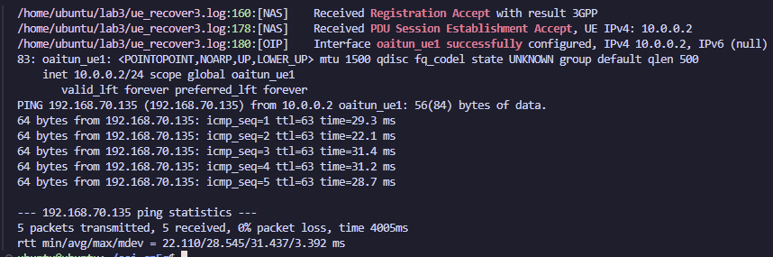

Figure 5-6. After restoring IMSI `001010000000001`: Registration Accept, PDU Session Establishment Accept (UE IPv4 10.0.0.2), `oaitun_ue1` configured, and ping succeeds with 5/5 replies and 0% loss.

**Questions:**

1. Why can the UE potentially synchronize with the gNB even when the IMSI is incorrect?

> Ans: Synchronization, random access, and RRC setup use only information the gNB broadcasts to all UEs; none of them check the UE's identity. The IMSI is first used in the NAS Registration Request. Our UE with the wrong IMSI synced and completed RRC (ue_bad.log:78–104) before being rejected.

2. Which network function is involved in UE authentication?

> Ans: The AMF (as SEAF) together with the AUSF, UDM, and UDR. Our logs show the full chain (Fig. 5-3): AMF → AUSF → UDM → UDR, where the SQL query found `no data!` and the 404 propagated back to the AMF as `CONTEXT_NOT_FOUND`.

3. Why does changing an IMSI affect Registration but not the RFsimulator TCP connection itself?

> Ans: The TCP connection only carries IQ samples between two processes and is set up before any 5G procedure; it knows nothing about subscribers. The IMSI is used only in NAS messages. During the failure, the connection stayed `ESTAB` (UE PID 362006 ↔ gNB PID 139400, Fig. 5-5) while registration failed.

4. What evidence proves that restoring the correct configuration solved the problem?

> Ans: After restarting with IMSI `001010000000001` (the core network was also restarted before this final run), the UE received Registration Accept (ue_recover3.log:160) and PDU Session Establishment Accept with 10.0.0.2 (:178), `oaitun_ue1` was created (:180), and ping succeeded with 5/5 replies, 0% loss, and an average RTT of 28.545 ms (Fig. 5-6). Only the NAS outcome changed between the failed and recovered runs, so the IMSI was the cause.

Submit evidence from both the failed and recovered connections.


## 8. Task 7 — Explain the Relationship Between Simulation and Real 5G

Your OAI gNB and nrUE perform 5G NR protocol processing even though they do not use physical antennas.

Complete the comparison:

| Feature | OAI RFsimulator | Physical 5G System |
|---|---|---|
| gNB and UE protocol stack | Full NR stack (PHY to NAS) in software; real RRC, Registration, and PDU Session observed | Same 3GPP stack, in commercial gNB equipment and UE modem chips |
| OFDM signal processing | Done in software on the CPU; IQ samples sent over TCP port 4043 | Done in baseband hardware or software, then converted to analog RF |
| Physical antennas | None; a TCP socket (127.0.0.1:4043) replaces the air link | Real antennas, often MIMO with beamforming |
| RF hardware impairments | None by default (no phase noise, CFO, IQ imbalance, non-linearity) | Always present and must be compensated |
| Wireless propagation effects | Ideal channel by default (SNR 51 dB, BLER 0) | Path loss, fading, multipath, Doppler, interference, noise |
| 5G Core connectivity | Real N2 (NGAP) and N3 (GTP-U) to OAI CN5G | Same interfaces to a carrier-grade 5G Core |

**Questions:**

1. Which parts of the 5G system remain functional when physical RF hardware is replaced with RFsimulator?
> Ans: Everything except the analog RF front-end and the wireless channel: the full gNB/UE protocol stack including the digital PHY, all NAS procedures, and the complete 5G Core and user plane. Our experiment showed every stage from sync to end-to-end ping.

2. Why is RFsimulator useful for testing the 5G protocol stack?
> Ans: It runs the whole system on one VM without SDR hardware or a spectrum license. The ideal, repeatable channel means failures can be traced to configuration or software, as in our IMSI test. The full PHY and MAC code is still exercised.

3. Why might latency and throughput differ between RFsimulator and a real 5G deployment?

> Ans: In RFsimulator, performance is limited by CPU processing on a shared VM; with the same 56-byte payload our average RTT ranged from 22.505 to 28.545 ms with no configuration change. Meanwhile, the ideal channel removes the retransmissions, fading, and interference of real networks, which in turn use dedicated hardware, MIMO, and wider bandwidths. So the results can be faster or slower than real 5G.

4. What would need to change if you wanted to test a physical UE instead of OAI nrUE?
> Ans:
> - **Radio hardware:** The gNB would need a real RF front-end, for example a USRP B210 (the configuration file we used, `gnb.sa.band78.fr1.106PRB.usrpb210.conf`, is designed for it), with antennas or cables. The gNB would be started without `--rfsim` so that it uses the SDR instead of the TCP socket.
> - **Radio configuration:** The band, center frequency, bandwidth, SSB position, and TDD pattern must be ones the commercial phone supports (n78 is widely supported).
> - **SIM card:** The phone would need a programmable SIM card containing an IMSI, key (K), and OPc that match a subscriber entry in the CN5G database, since a phone cannot be given an IMSI on the command line like `--uicc0.imsi`. The PLMN (MCC/MNC) and the DNN configured on the phone must also match the core network.
> - **Real-time performance:** The host would need enough real-time performance, ideally a native Linux machine with a high-performance CPU and a USB 3 connection to the SDR rather than a VM, because the radio must meet strict timing.
> - **Regulation and safety:** Transmitting in licensed spectrum requires a license or a shielded (Faraday) environment.
> - **Measurement conditions:** The measurements would then include real RF impairments and propagation effects, so results would no longer be reproducible in the same way.

## 9. Final Analysis

1. Describe the complete process from starting the OAI 5GC to successful user-plane connectivity.

> Ans: `docker compose up -d` started the CN5G, and all containers became healthy. The gNB then completed NG Setup with the AMF (gnb.log:76, 86) and listened on TCP 4043. The UE connected, synchronized, and set up RRC (gnb.log:215), then registered via AMF/AUSF/UDM/UDR (ue_ok.log:157). Finally, a PDU session gave the UE 10.0.0.2 and created `oaitun_ue1` (ue_ok.log:175, 177), and ping succeeded with 10/10 replies.

2. Explain the difference between an RFsimulator TCP connection and a 5G PDU Session.

> Ans: The RFsimulator TCP connection is a transport link between two processes that carries IQ samples in place of a radio channel; it exists before any 5G procedure. A PDU session is a 5G user-plane connection set up by the SMF/UPF after registration, giving the UE an IP address and a GTP-U tunnel. Task 5 showed they are independent: the TCP connection stayed `ESTAB` while no PDU session existed.

3. Based on your measurements, how did packet size affect RTT and packet loss?

> Ans: Packet size had no effect on packet loss: all six runs (180 pings in total) had 0% loss, which reflects the ideal simulated channel. For RTT, the largest packets (1200-byte payload) had the highest average in both runs (29.761 ms and 26.579 ms), giving an RTT difference C − A of 5.972 ms in run 1 and 4.074 ms in run 2. The medium packets did not show a consistent increase: B was 3.0 ms slower than A in run 1 but only 0.163 ms slower in run 2, which is within the measurement deviation (mdev 1.4–2.4 ms). Because B itself varied by 4.1 ms between runs, the run-to-run variation was comparable to the packet-size effect, so we conclude that large packets moderately increase RTT, but packet size is not the dominant factor in this environment.

4. Describe the registration failure you introduced and explain how you diagnosed and recovered from it.

> Ans: We changed the IMSI to `001010000000099`, which is not in the subscriber database. The UE synced and set up RRC but received a Registration Reject; the core logs showed the UDR returning 404, which reached the AMF as `CONTEXT_NOT_FOUND`. After restoring IMSI `001010000000001` (with the core network restarted), registration, the PDU session, and ping all succeeded again.

5. Identify two limitations of this simulated environment and explain how they might affect experimental results.

> Ans: First, the channel is ideal (SNR 51 dB, BLER 0, 0% loss), so retransmissions, link adaptation, and packet loss are never tested. Second, all components share one VM's CPU, so RTT depends on processing load; our 56-byte average ranged from 22.505 to 28.545 ms. The results are therefore good for functional checks and relative comparisons, but not for real 5G performance.

## 10. Submission Checklist

Submit one Markdown or PDF report containing:

- Completed 5G SA connection verification table.
- gNB and nrUE connection screenshots.
- RFsimulator TCP connection evidence.
- Baseline Ping measurement.
- Three packet-size comparison results.
- RTT difference calculation.
- Controlled failure and recovery evidence.
- RFsimulator versus physical 5G comparison.
- Answers to the final analysis questions.

All measurements and log evidence must come from your own experimental environment.

## 11. Grading Rubric

| Item | Points |
|---|---:|
| Complete 5G SA deployment | 15 |
| RFsimulator TCP connection analysis | 15 |
| End-to-end user-plane verification | 15 |
| Packet-size experiment and analysis | 20 |
| Controlled failure and recovery | 20 |
| Simulation limitations and final analysis | 15 |
| **Total** | **100** |

Vote TOP3：https://forms.gle/Mvza68DFBzPcZXfW6