# Lab 4 — 5G CU/DU Split Deployment and F1-C/F1-U Analysis

**Student handout**  
**Environment:** Ubuntu 24.04 LTS · OpenAirInterface (OAI) v2.4.0 · RFsimulator · no SDR required  
**Prerequisite:** Lab 3 completed successfully (OAI CN5G, gNB, nrUE, UE tunnel and Ping)

> **Lab objective:** Replace the monolithic gNB from Lab 3 with a split gNB-CU and gNB-DU. Capture and analyze both **F1-C** (F1AP over SCTP) and **F1-U** (GTP-U over UDP) in a single PCAP file. Verify that the UE can still establish a PDU session and reach the external data network.
>
> **Instructor validation:** This lab's CU/DU split, F1 Setup, UE RRC signaling, UE Context procedures, GTP-U T-PDUs, and external-DN Ping were observed on the classroom OAI v2.4.0 environment. Exact IP addresses, frequencies and core network configuration must be checked on each student image.

---

## 1. Learning objectives

After completing this lab, you should be able to:

1. Explain the functional division between gNB-CU and gNB-DU.
2. Deploy a split 5G SA RAN with OAI and RFsimulator.
3. Identify **F1-C** control-plane messages (F1 Setup, RRC transfer, UE Context Setup).
4. Identify **F1-U** user-plane GTP-U packets, including their direction and TEID.
5. Verify UE IP connectivity through the split architecture.
6. Distinguish F1-U from the separate **N3** interface, even though both can use GTP-U.

## 2. Network architecture and experimental parameters

```text
                         OAI 5G Core
                     AMF / SMF / UPF
                           |
                   N2 (NGAP) / N3 (GTP-U)
                           |
                      +----------+
                      |  gNB-CU  |  F1-C IP: 127.0.0.3
                      | RRC/PDCP |  (example classroom setup)
                      +----------+
                         |     |
        F1-C: F1AP/SCTP |     | F1-U: GTP-U/UDP
                         |     |
                      +----------+
                      |  gNB-DU  |  F1 IP: 127.0.0.4
                      |RLC/MAC/PHY|
                      +----------+
                           |
                    RFsimulator (IQ/TCP)
                           |
                         nrUE
                           |
                      oaitun_ue1
                           |
                       ICMP Ping
```

| Parameter | Classroom configuration |
|---|---|
| OAI version | `v2.4.0` |
| RAN | One gNB-CU + one gNB-DU + one nrUE |
| Radio | RFsimulator, no physical SDR |
| NR band | n78 |
| Bandwidth | 106 PRBs |
| Numerology | 1 (30 kHz SCS) |
| CU F1 address (observed) | `127.0.0.3` |
| DU F1 address (observed) | `127.0.0.4` |
| DU SSB NR-ARFCN (observed) | `630048` (3,450.72 MHz) |
| UE frequency argument used in successful split test | `-C 3450720000` |
| UE IMSI | `001010000000001` |
| External DN | `192.168.70.135` |

**Important:** The Lab 3 monolithic gNB config used `absoluteFrequencySSB = 641280` (3,619.20 MHz), whereas the split DU config used `630048` (3,450.72 MHz). The frequency parameters **must match the working DU/UE pair**. Do not reuse Lab 3's `-C 3619200000` without checking the DU configuration. The `-C` argument and effective radio carrier placement should be verified against OAI startup logs; the above value is the one used in the successful classroom test, not a general formula for every DU file.

---

## 3. Task 1 — Inspect the split configurations

### Step 1. Confirm the configuration files exist

```bash
cd ~/openairinterface5g-v2.4.0

ls -l \
  targets/PROJECTS/GENERIC-NR-5GC/CONF/gnb-cu.sa.f1.conf \
  targets/PROJECTS/GENERIC-NR-5GC/CONF/gnb-du.sa.band78.106prb.rfsim.pci0.conf
```

### Step 2. Check frequency and F1 network settings

```bash
grep -nE \
'absoluteFrequencySSB|dl_absoluteFrequencyPointA|dl_carrierBandwidth|physCellId|min_rxtxtime|local_s_address|remote_s_address|local_n_address|remote_n_address|local_s_portd|remote_s_portd|local_n_portd|remote_n_portd|amf_ip_address' \
  targets/PROJECTS/GENERIC-NR-5GC/CONF/gnb-cu.sa.f1.conf \
  targets/PROJECTS/GENERIC-NR-5GC/CONF/gnb-du.sa.band78.106prb.rfsim.pci0.conf
```

**Record:** The CU and DU F1 addresses, the DU SSB frequency, and PRB count. If the local settings differ from the table above, adapt the following commands and capture filters accordingly.

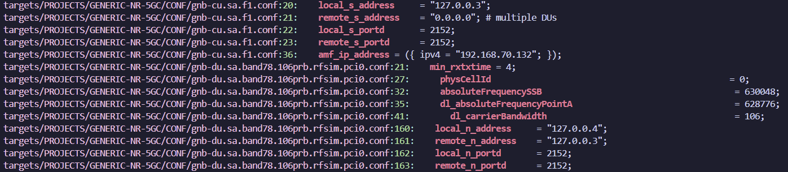

| Parameter | Observed value |
|---|---|
| CU F1 address (`local_s_address`) | 127.0.0.3 (`remote_s_address = 0.0.0.0`, accepts any DU) |
| DU F1 address (`local_n_address` → `remote_n_address`) | 127.0.0.4 → 127.0.0.3 |
| F1-U port (`*_portd`) | 2152 (CU and DU) |
| DU SSB (`absoluteFrequencySSB`) | 630048 (3450.72 MHz) |
| DU Point A (`dl_absoluteFrequencyPointA`) | 628776 |
| Bandwidth (`dl_carrierBandwidth`) | 106 PRBs |
| PCI (`physCellId`) | 0 |
| AMF (`amf_ip_address`) | 192.168.70.132 (matches the `oai-amf` container IP) |
| UE frequency | `-C 3450720000`, matching the DU SSB; Lab 3 used 641280 / 3619.2 MHz |

**Questions**

1. Which protocol layers mainly reside in the CU, and which reside in the DU?
> Ans : The CU hosts the higher layers: RRC, SDAP, and PDCP, plus the NG interface to the 5G Core (our CU performed NG Setup with the AMF at 192.168.70.132, cu.log:26, 30). The DU hosts the lower, timing-critical layers: RLC, MAC, and PHY, and it is the node the UE actually talks to over the radio (our DU ran the RFsimulator server with --rfsim). This is also visible in the capture: the F1-U payload is a PDCP PDU, because PDCP terminates in the CU.
2. What is the purpose of the F1 interface?
> Ans : F1 connects the gNB-CU and gNB-DU so that together they act as one gNB. F1-C (F1AP over SCTP) carries control signaling: F1 Setup, transfer of RRC messages between UE and CU, and UE context management. F1-U (GTP-U over UDP 2152) carries the UE’s user-plane data between the PDCP in the CU and the RLC in the DU. In our setup, F1 runs between 127.0.0.4 (DU) and 127.0.0.3 (CU).
3. Why must the UE radio frequency be compatible with the DU rather than taken blindly from the previous lab?
> Ans : The DU, not the CU, owns the radio, so the UE must tune to the frequency where the DU broadcasts its SSB. The Lab 4 DU uses absoluteFrequencySSB = 630048 (3450.72 MHz), while the Lab 3 gNB used 641280 (3619.20 MHz). With Lab 3’s -C 3619200000, the UE would search the wrong frequency and fail to detect the SSB or decode SIB1; with -C 3450720000, it achieved Initial sync successful, PCI: 0 and SIB1 decoded (ue.log:78, 105).

---

## 4. Task 2 — Deploy the split 5G SA network

Before starting, stop the monolithic Lab 3 gNB and any old nrUE processes with `Ctrl+C`. Avoid running two gNB/DU RFsimulator servers on the same listening port.

### Terminal 1 — Start CN5G

```bash
cd ~/oai-cn5g
docker compose up -d
docker compose ps
```

### Terminal 2 — Start gNB-CU

```bash
cd ~/openairinterface5g-v2.4.0/cmake_targets/ran_build/build

sudo ./nr-softmodem \
  -O ../../../targets/PROJECTS/GENERIC-NR-5GC/CONF/gnb-cu.sa.f1.conf
```

### Terminal 3 — Start gNB-DU

**Start the packet capture in Task 3 *before* starting the DU if you want to record the initial F1 Setup handshake.**

```bash
cd ~/openairinterface5g-v2.4.0/cmake_targets/ran_build/build

sudo ./nr-softmodem \
  -O ../../../targets/PROJECTS/GENERIC-NR-5GC/CONF/gnb-du.sa.band78.106prb.rfsim.pci0.conf \
  --rfsim
```

### Terminal 4 — Start nrUE

```bash
cd ~/openairinterface5g-v2.4.0/cmake_targets/ran_build/build

sudo ./nr-uesoftmodem \
  -r 106 \
  --numerology 1 \
  --band 78 \
  -C 3450720000 \
  --uicc0.imsi 001010000000001 \
  --rfsim \
  --rfsimulator.serveraddr 127.0.0.1
```

> **Instructor note:** This UE command reflects the working classroom split configuration. In particular, the original Lab 3 `-C 3619200000` setting was not compatible with this DU configuration. If a provided classroom image has different NR frequencies or UICC credentials, use the instructor-validated values.

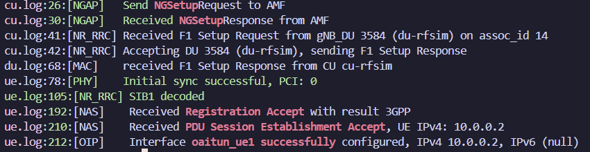

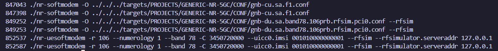


### Check the UE connection

```bash
ip -4 addr show oaitun_ue1
ping -I oaitun_ue1 -c 10 192.168.70.135
```

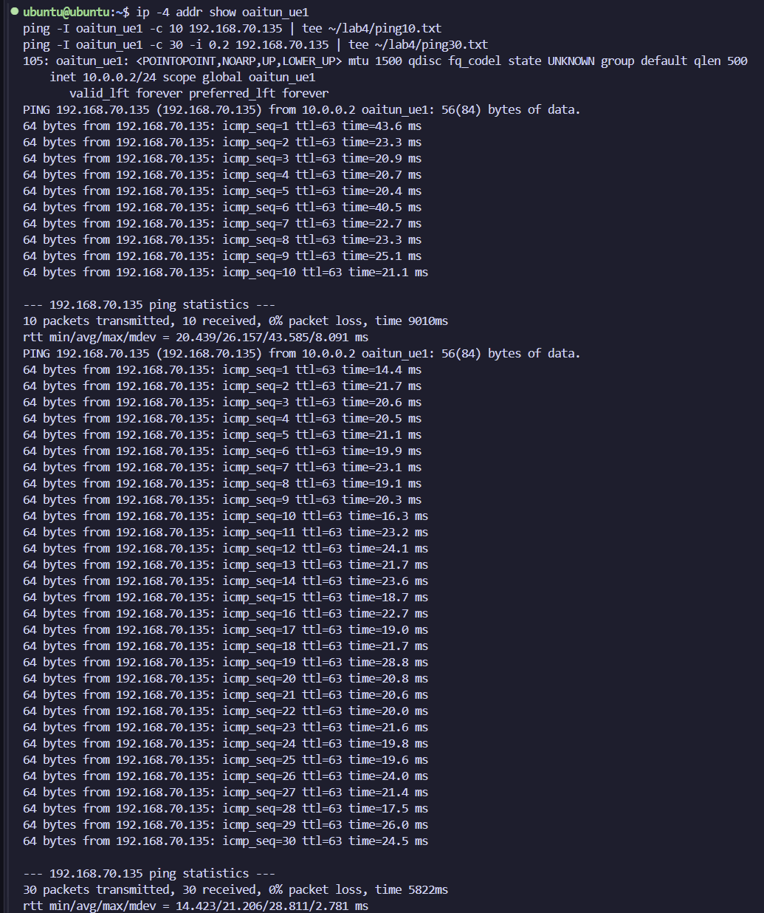

| Measurement | 10-ping test | 30-ping test (during capture) |
|---|---|---|
| UE IP (`oaitun_ue1`) | 10.0.0.2 | 10.0.0.2 |
| Transmitted / received | 10 / 10 | 30 / 30 |
| Packet loss | 0% | 0% |
| RTT min / avg / max (ms) | 20.439 / 26.157 / 43.585 | 14.423 / 21.206 / 28.811 |


**Evidence:** Screenshots of CU/DU startup, UE connection, and successful Ping. Record the observed UE IP, transmitted/received packets, packet loss, and average RTT. Do **not** invent values; they vary by machine.

---

## 5. Task 3 — Capture F1-C and F1-U in a single PCAP

The classroom capture showed CU `127.0.0.3` and DU `127.0.0.4` on the Linux loopback interface (`lo`).

### Step 1. Start packet capture

Start CN5G and CU, but **before starting the DU** open another terminal:

```bash
sudo tcpdump -i lo -s 0 -nn \
  -w ~/lab4-f1-complete.pcap \
  'host 127.0.0.3 and host 127.0.0.4 and (sctp or udp port 2152)'
```

This captures:

- **F1-C:** F1AP carried over SCTP.
- **F1-U:** GTP-U carried over UDP port 2152, **provided the configured F1-U endpoints and port match these values**.

### Step 2. Trigger control-plane and user-plane traffic

1. Start the DU to trigger **SCTP association** and **F1 Setup**.
2. Start nrUE to trigger **RRC** and **UE Context** procedures.
3. After the UE tunnel appears, generate traffic:

```bash
ping -I oaitun_ue1 -c 30 -i 0.2 192.168.70.135
```

4. Press `Ctrl+C` in the **tcpdump terminal** to finish and save the PCAP.
5. Verify the file:

```bash
ls -lh ~/lab4-f1-complete.pcap
```


### Alternative: capture all traffic between CU and DU

If you are unsure of the F1-U UDP port, use this **instead of** the filtered capture above:

```bash
sudo tcpdump -i lo -s 0 -nn \
  -w ~/lab4-f1-all.pcap \
  'host 127.0.0.3 and host 127.0.0.4'
```

If the CU and DU are not communicating over `lo`, select the correct interface (`ip -br addr` or `tcpdump -D`) and update the IP filter.

---

## 6. Task 4 — Analyze F1-C (F1AP / SCTP)

Open the capture:

```bash
wireshark ~/lab4-f1-complete.pcap
```

Useful **Wireshark display filters**:

```text
sctp
f1ap
```

Find and record these messages:

| Message | Typical direction | Meaning |
|---|---|---|
| SCTP INIT / INIT_ACK / COOKIE_ECHO / COOKIE_ACK | DU ↔ CU | Establish SCTP association |
| F1 Setup Request | DU → CU | DU initiates F1 connection and provides served-cell information |
| F1 Setup Response | CU → DU | CU accepts F1 Setup |
| GNBDUConfigurationUpdate | DU → CU | DU informs CU of configuration changes |
| Initial UL RRC Message Transfer (RRC Setup Request) | DU → CU | UE initial RRC request forwarded to CU |
| DL RRC Message Transfer (RRC Setup) | CU → DU | CU delivers RRC Setup toward UE |
| UL RRC Message Transfer (RRC Setup Complete) | DU → CU | UE completes RRC procedure; NAS Registration Request can be carried inside |
| UE Context Setup Request / Response | CU ↔ DU | Establish UE-specific resources/context |
| DL RRC Message Transfer (RRC Reconfiguration) | CU → DU | CU sends further RRC configuration |

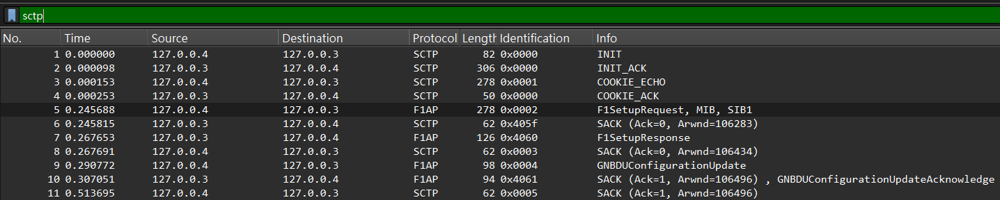 
> Packets 1–4: SCTP association (INIT / INIT_ACK / COOKIE_ECHO / COOKIE_ACK) initiated by the DU (127.0.0.4). Packet 5: F1SetupRequest (DU → CU, carrying MIB and SIB1). Packet 7: F1SetupResponse (CU → DU). Packets 9–10: GNBDUConfigurationUpdate and its Acknowledge.

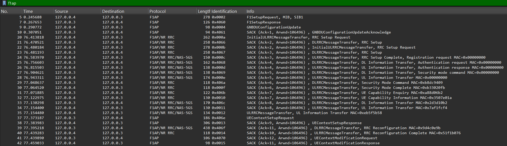
> Packets 20–24: RRC Setup Request / RRC Setup / RRC Setup Complete carried in Initial UL, DL, and UL RRC Message Transfer; packet 24 also carries the NAS Registration Request. Packets 25–35: authentication, security mode, and UE capability exchange. Packets 37–38: UE Context Setup Request / Response. Packets 39–40: RRC Reconfiguration / Complete. Packets 41–42: UE Context Modification. RRC Setup Request / RRC Setup appear twice (packets 20–23), indicating that the UE retried once.

**Observed classroom sequence:** The successful capture contained SCTP association, F1 Setup Request/Response, DU Configuration Update/Acknowledgement, RRC Setup messages, Authentication signaling carried through RRC, UE Context Setup/Modification, and RRC Reconfiguration. The exact packet numbers and timing are **not fixed**.

**Questions**

1. Which node initiates F1 Setup, and which acknowledges it?
> Ans : The DU initiates it and the CU acknowledges it. In our capture, the DU (127.0.0.4) sent the F1SetupRequest (packet 5), and the CU (127.0.0.3) answered with the F1SetupResponse (packet 7). The CU log confirms this: Received F1 Setup Request from gNB_DU 3584 and Accepting DU 3584, sending F1 Setup Response (cu.log:41–42).
2. Explain the difference between SCTP association establishment and F1 Setup.
> Ans : The SCTP association is a transport-layer connection: the four-way handshake INIT / INIT_ACK / COOKIE_ECHO / COOKIE_ACK (packets 1–4) only creates a reliable channel between 127.0.0.4 and 127.0.0.3 (port 38472). F1 Setup is an application-layer F1AP procedure that runs over that channel. In it, the DU identifies itself and describes its cell to the CU. In our packet 5, this included gNB-DU-ID 3584, PCI 0, SSB frequency 630048, TAC 1, and the MIB/SIB1. SCTP must succeed first, but only F1 Setup makes the DU an operational part of the gNB.
3. How can a NAS Registration Request be transported over F1-C?
> Ans : It is nested inside other messages. The NAS Registration Request is carried inside an RRC message (RRC Setup Complete), and the DU forwards that RRC message to the CU inside an F1AP UL RRC Message Transfer. In our capture, packet 24 is ULRRCMessageTransfer, RRC Setup Complete, Registration request, and Wireshark labels its protocol as F1AP/NR RRC/NAS-5GS, showing the three nested layers. The DU only relays the message: the CU handles the RRC part and forwards the NAS part to the AMF over NGAP.
4. What is the role of UE Context Setup?
> Ans : UE Context Setup lets the CU create the UE-specific context in the DU, once the UE has been authenticated and security is active. This context includes the radio bearers (SRB2/DRB), the RLC/MAC configuration, and the F1-U tunnel information needed for user data. In our capture, the UEContextSetupRequest (packet 37, CU → DU) and Response (packet 38) were followed by RRC Reconfiguration (packets 39–40). The F1-U GTP-U traffic appeared only after these steps.
5. Does F1 Setup alone prove successful UE Registration? Explain.
> Ans : No. F1 Setup is a node-level procedure between the DU and CU, and it happened at 0.27 s in our capture, about 76 s before the UE even started (packet 20). UE Registration requires the separate steps that followed: the UE’s RRC setup, NAS Registration with authentication and security mode (packets 20–35), and the AMF’s Registration Accept (ue.log:192). Even registration alone is not enough for data: the PDU session (ue.log:210) and the oaitun_ue1 tunnel (ue.log:212) are also needed, as confirmed by the successful ping.

**Evidence:** Screenshot with F1 Setup Request/Response and screenshot with at least three UE-associated F1AP messages. Include packet numbers and source/destination addresses.

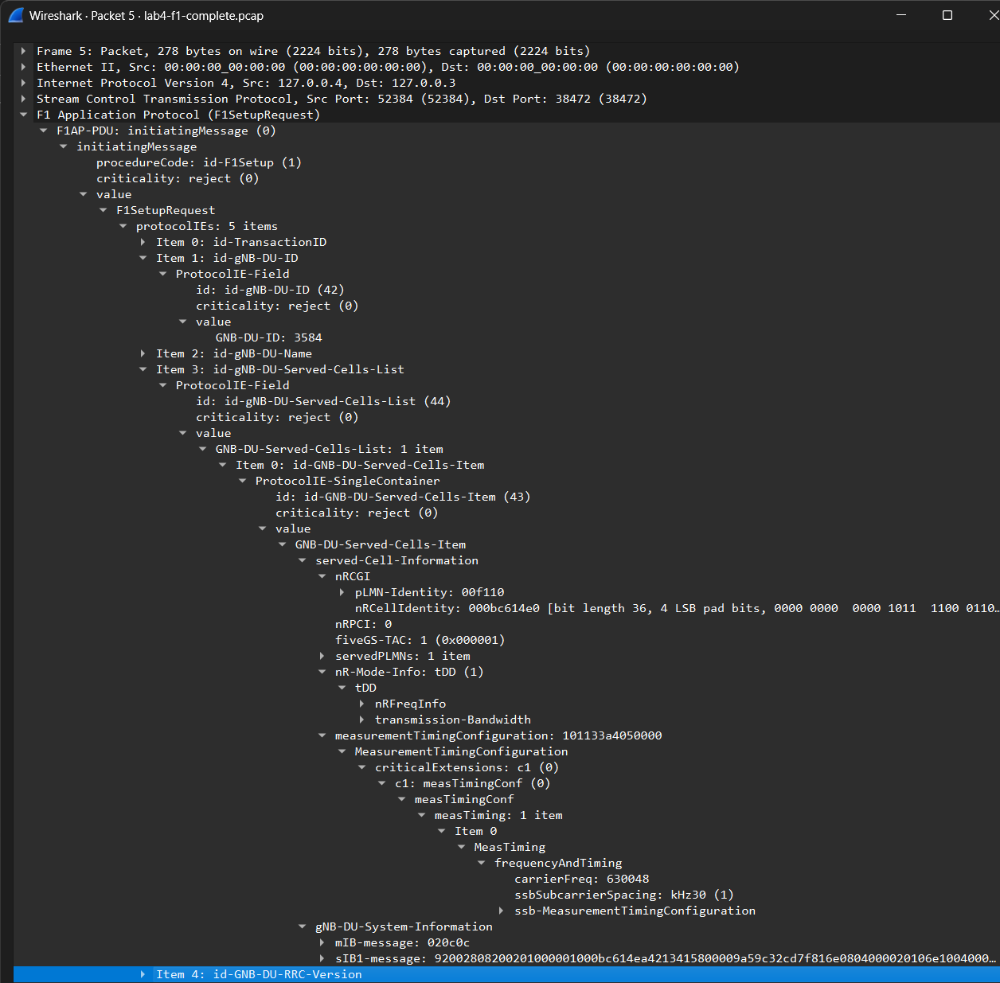
> The F1SetupRequest carries gNB-DU-ID 3584, PCI 0, TAC 1, SSB carrier frequency 630048 (matching the DU configuration), TDD mode, and the DU’s MIB/SIB1. It was sent over SCTP from port 52384 to the standard F1-C port 38472.

---

## 7. Task 5 — Analyze F1-U (GTP-U / UDP)

In the **same PCAP**, apply:

```text
gtp
```

If necessary, first check:

```text
udp.port == 2152
```

Directional display filters (based on the observed classroom CU/DU IP pair):

```text
gtp && ip.src == 127.0.0.4 && ip.dst == 127.0.0.3
gtp && ip.src == 127.0.0.3 && ip.dst == 127.0.0.4
```

In the captured GTP-U packet details, inspect:

```text
Internet Protocol (outer CU/DU addresses)
  User Datagram Protocol
    GPRS Tunneling Protocol (GTP-U)
      Message Type: G-PDU / T-PDU
      Tunnel Endpoint Identifier (TEID)
      Encapsulated user payload (if decodable)
```

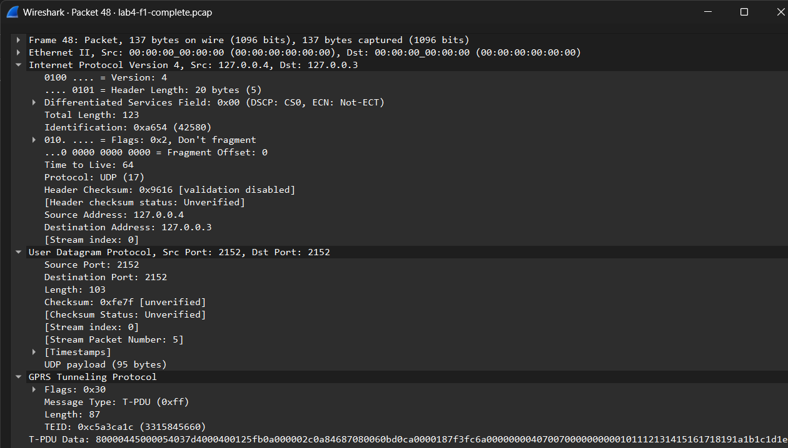 
> F1-U uplink G-PDU from the DU (127.0.0.4) to the CU (127.0.0.3), UDP 2152, TEID 0xc5a3ca1c. The 87-byte T-PDU consists of a 3-byte PDCP header (SN 4) followed by the UE’s IPv4 packet (10.0.0.2 → 192.168.70.135, ICMP Echo Request, id 0x0ca0, seq 1).

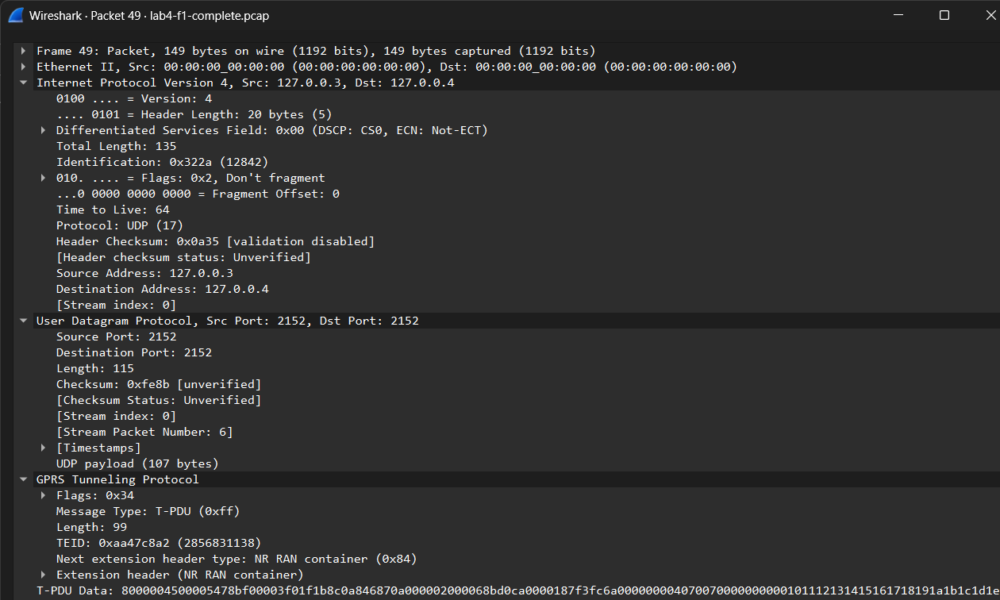
> F1-U downlink G-PDU from the CU (127.0.0.3) to the DU (127.0.0.4), UDP 2152, TEID 0xaa47c8a2, with an NR RAN container extension header (0x84). The payload is a PDCP PDU (SN 0) containing the ICMP Echo Reply (192.168.70.135 → 10.0.0.2, id 0x0ca0, seq 1, TTL 63), i.e., the reply to packet 48.


**Important:** The classroom trace showed repeated `GTP T-PDU` packets from `127.0.0.4` (DU) to `127.0.0.3` (CU), confirming traffic on the CU–DU user-plane path. The actual TEID was **not recorded** in the provided screenshot: read the TEID from your own packet details instead of assuming a value.

### Distinguish F1-U from N3

Both **F1-U** and **N3** can use GTP-U. Do **not** classify traffic as F1-U solely because Wireshark says `GTP` or the port is `2152`.

- **F1-U:** GTP-U between **gNB-DU and gNB-CU**.
- **N3:** GTP-U between **gNB-CU and 5GC UPF**.

Identify the interface using the actual source/destination endpoints and configuration.

>To compare F1-U with N3, a separate capture was taken on the core-network bridge while the UE was pinging:
 >   sudo tcpdump -i oai-cn5g -s 0 -nn -w ~/lab4-n3.pcap 'udp port 2152'
>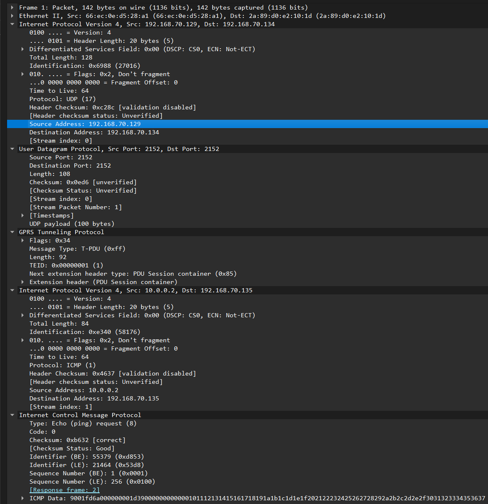
> N3 G-PDU (separate capture on oai-cn5g): outer IP 192.168.70.129 (CU NG-U) → 192.168.70.134 (UPF), UDP 2152, TEID 0x00000001, PDU Session Container (0x85). The payload is the UE’s plain IPv4 packet (10.0.0.2 → 192.168.70.135, ICMP Echo Request), with no PDCP header.

**Questions**

1. Which transport protocol carries F1-U?
> Ans : UDP. F1-U carries GTP-U over UDP port 2152. In our capture, every F1-U packet uses source and destination port 2152 between 127.0.0.4 and 127.0.0.3 (e.g., packets 48 and 49), matching local_n_portd/remote_n_portd = 2152 in the DU configuration.
2. What does a GTP-U **TEID** identify?
> Ans : The TEID (Tunnel Endpoint Identifier) identifies the tunnel at the receiving endpoint, so that the receiver knows which UE and which bearer the packet belongs to. Each direction has its own tunnel, with a TEID chosen by its receiver. In our capture, the uplink tunnel uses TEID 0xc5a3ca1c (packets 43, 45, 48) and the downlink tunnel uses TEID 0xaa47c8a2 (packet 49), both serving the same UE data bearer.
3. Which direction is `127.0.0.4 → 127.0.0.3` in this setup?
> Ans : Uplink (DU → CU): it carries the UE’s data from the DU toward the CU and the core network. For example, packet 48 contains the UE’s ICMP Echo Request from 10.0.0.2 to 192.168.70.135. We counted 45 uplink packets in this direction (40 Echo Requests plus 5 IPv6 Router Solicitations) and 40 downlink packets (127.0.0.3 → 127.0.0.4, the Echo Replies).
4. How would you distinguish F1-U from N3 in a packet capture?
> Ans : Mainly by the outer IP endpoints. Our F1-U packets run between the DU and CU (127.0.0.4 ↔ 127.0.0.3 on lo, e.g., packet 48), while our N3 packets run between the CU’s NG-U address and the UPF (192.168.70.129 → 192.168.70.134 on oai-cn5g). The GTP-U contents also differ. F1-U carries PDCP PDUs (packet 48’s payload begins with the PDCP header 80 00 04), so Wireshark shows only T-PDU, and the downlink uses an NR RAN container (0x84). N3 carries the UE’s plain IP packet with a PDU Session Container (0x85), so Wireshark decodes it directly as GTP/ICMP (10.0.0.2 → 192.168.70.135). Both use UDP 2152 and are labeled GTP, so the port and protocol name alone cannot tell them apart.
5. Why do F1-C and F1-U use different transport protocols?
> Ans : They have different requirements. F1-C carries signaling (F1 Setup, RRC messages, UE context), which must arrive reliably and in order, so it uses SCTP. SCTP also provides association setup and heartbeats, which we observed in packets 1–4 and the periodic HEARTBEAT messages. F1-U carries large volumes of user data, where low overhead and low latency matter more than transport-level retransmission, so it uses lightweight GTP-U over UDP; reliability for user data is handled by higher layers (PDCP/RLC or the application). This follows the same pattern as NG (NGAP over SCTP for N2, GTP-U over UDP for N3).

**Evidence:** Screenshot of at least one GTP-U T-PDU, with outer IP addresses, UDP ports, message type, and TEID visible. Record the observed UL and DL packet counts (if both directions are present). Do not assume equal counts.

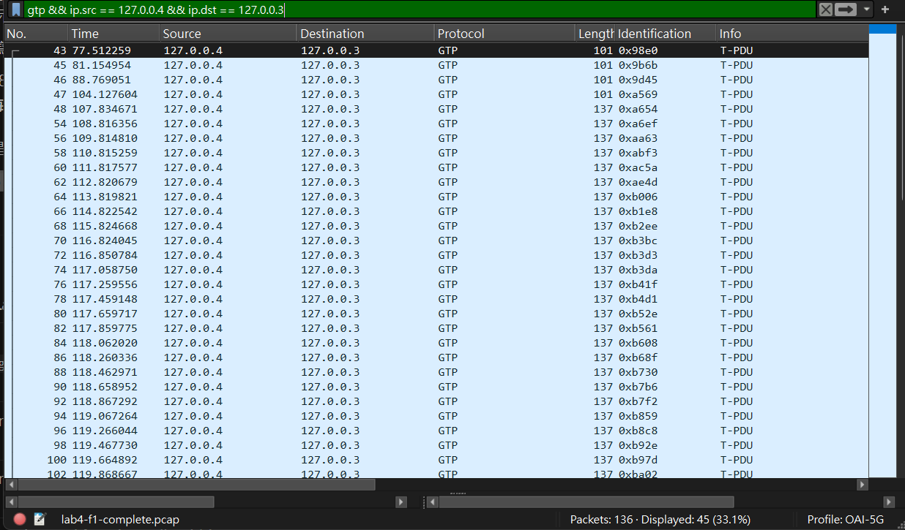

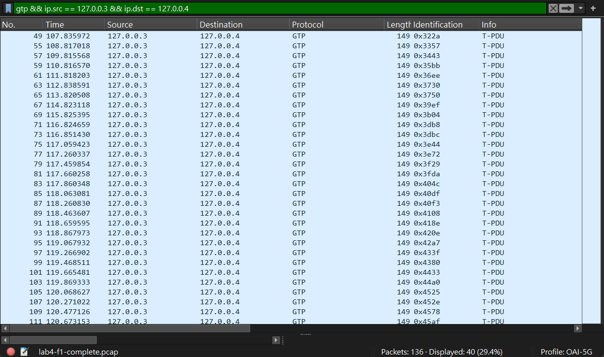

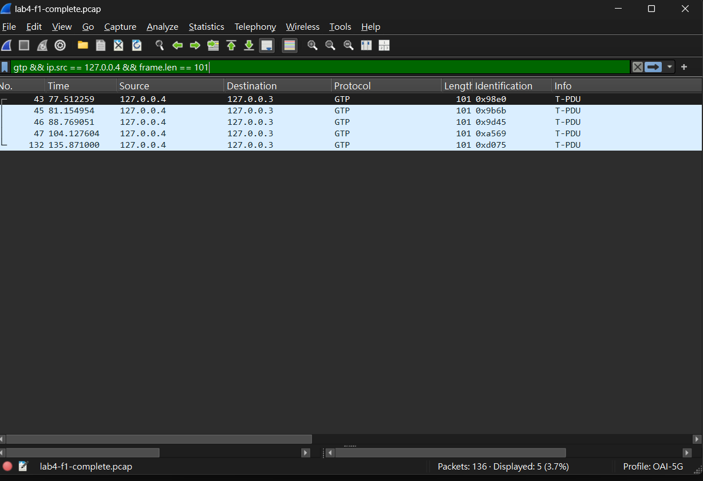

*The 5 extra uplink packets (frame length 101 bytes: packets 43, 45, 46, 47, 132) are IPv6 Router Solicitations sent by the UE's `oaitun_ue1` interface at roughly doubling intervals (≈3.6, 7.6, 15.4, 31.7 s). Together with the 40 ICMP Echo Requests, they account for the 45 uplink T-PDUs.*

---

## 8. Task 6 — Compare monolithic and split gNB

Complete the table:

| Feature | Lab 3: Monolithic gNB | Lab 4: CU/DU Split |
|---|---|---|
| Number of RAN processes |1 gNB process (nr-softmodem with gnb.sa.band78...usrpb210.conf) + nrUE|2 gNB processes: CU (gnb-cu.sa.f1.conf) and DU (gnb-du...rfsim.pci0.conf) + nrUE|
| Location of RRC/PDCP |Inside the single gNB process|gNB-CU (127.0.0.3)|
| Location of RLC/MAC/PHY |Inside the single gNB process|gNB-DU (127.0.0.4)|
| F1-C interface present? |No|Yes: F1AP over SCTP, 127.0.0.4:52384 → 127.0.0.3:38472; F1 Setup in packets 5/7|
| F1-U interface present? |No|Yes: GTP-U over UDP 2152; 45 UL and 40 DL T-PDUs captured (UL TEID 0xc5a3ca1c, DL TEID 0xaa47c8a2)|
| UE connected to the same 5GC? |Yes: OAI CN5G, AMF 192.168.70.132, IMSI 001010000000001|Yes: same CN5G and AMF (CU amf_ip_address = 192.168.70.132), same IMSI|
| End-to-end Ping works? |Yes: UE IP 10.0.0.2, 10/10, 0% loss, avg 23.372 ms|Yes: UE IP 10.0.0.2, 10/10, 0% loss, avg 26.157 ms; 30/30, 0% loss, avg 21.206 ms|

Explain in **3–5 sentences** why splitting a gNB changes the internal RAN interfaces but does not change the UE's need for synchronization, registration and a PDU session.

> Ans : Splitting the gNB only moves the boundary inside the RAN: RRC and PDCP run in the CU while RLC, MAC, and PHY run in the DU, so messages that were internal function calls in Lab 3 now cross the F1-C (F1AP/SCTP) and F1-U (GTP-U/UDP) interfaces. From the UE’s point of view, the air interface is unchanged: it still has to synchronize to the SSB broadcast by the DU (Initial sync successful, SIB1 decoded), set up RRC with the CU, register with the same AMF through NAS, and obtain a PDU session before it can send data. Our capture shows exactly this, with the same RRC Setup, Registration, Authentication, Security Mode, and RRC Reconfiguration sequence as in Lab 3, now relayed between DU and CU inside F1AP RRC Message Transfer messages. As a result, the UE received the same IP address (10.0.0.2) and reached the same data network with 0% packet loss, confirming that the split is transparent to the UE and the 5G Core.

---

## 9. Troubleshooting

| Symptom | First checks |
|---|---|
| DU cannot establish F1 Setup | CU running; CU/DU F1 IP and ports; SCTP association; `f1ap` capture |
| UE repeatedly fails to decode SIB1 | Verify DU `absoluteFrequencySSB` and UE `-C`; check PHY/MAC synchronization and DU logs |
| UE syncs but Registration fails | Check CU/AMF logs, subscriber credentials (IMSI/key/OPc), RRC/NAS progress |
| UE attaches but no `oaitun_ue1` | Check PDU Session Establishment, 5GC SMF/UPF and UE logs |
| Ping fails | Confirm the tunnel, external DN reachability, routing, and user-plane path |
| Only F1AP appears in PCAP | Run Ping; verify PDU session; verify F1-U endpoints/port and capture interface |
| GTP appears but could be N3 | Check source/destination IPs against DU, CU and UPF addresses |
| Wireshark does not decode UDP 2152 as GTP-U | Examine UDP payload and optionally use **Analyze → Decode As…** |

**Do not** assume a screenshot of F1 Setup proves that UE Registration and end-to-end connectivity have succeeded. Validate each stage separately.

---

## 10. Submission checklist

Submit **one Markdown or PDF report** and **one PCAP file** containing:

- [ ] CU/DU configuration summary and frequency check.
- [ ] CU/DU and nrUE running evidence.
- [ ] UE tunnel IP and successful Ping result (loss and RTT).
- [ ] One PCAP containing **F1-C and F1-U**.
- [ ] F1 Setup Request/Response screenshot.
- [ ] Three or more UE-related F1AP messages with explanation.
- [ ] At least one GTP-U T-PDU screenshot with TEID and endpoints.
- [ ] Explanation distinguishing F1-C, F1-U and N3.
- [ ] Completed monolithic-vs-split comparison table.
- [ ] Answers to all analysis questions.

All screenshots, packet numbers, TEIDs and measurements must come from **your own experiment**.

## 11. Suggested grading rubric

| Category | Points |
|---|---:|
| Correct CU/DU deployment and parameter verification | 20 |
| F1-C capture and F1 Setup analysis | 20 |
| RRC/UE Context messages over F1-C | 20 |
| F1-U GTP-U and TEID analysis | 20 |
| UE tunnel and end-to-end Ping | 10 |
| Monolithic vs split comparison and report quality | 10 |
| **Total** | **100** |

---

## 12. Stop the experiment

Stop nrUE, DU and CU with `Ctrl+C`. Then stop CN5G:

```bash
cd ~/oai-cn5g
docker compose down
```

**Takeaway:** In the same OAI 5G SA network, **F1-C** exchanges RAN control signaling between CU and DU using **F1AP/SCTP**, while **F1-U** transports UE user-plane data between CU and DU using **GTP-U/UDP**. A successful UE Ping validates the end-to-end data path, while the PCAP shows what happens on the internal split-RAN interface.