# Lab 5: From Initial Access to RRC Connection Setup

## 1. Lab Goal

In Lab 1, you observed UE registration with the 5GC and the establishment of data service. This lab moves the observation point earlier: before registering with the Core network, how does a UE find a gNB, obtain cell system information, perform Random Access, and finally establish an RRC connection?

The main procedure in this lab is:

```text
Cell search / initial synchronization
→ MIB / SIB1
→ Msg1 PRACH
→ Msg2 RAR
→ Msg3 RRCSetupRequest
→ Msg4 RRCSetup
→ RRCSetupComplete
→ RRC_CONNECTED
```

This lab ends at `RRC_CONNECTED`. NAS Registration, Authentication, and PDU Session establishment belong to the Core network scope covered in Lab 1.

## 2. Evidence Used in This Lab

You will receive three files produced by the same successful OAI run:

| File | Purpose |
|---|---|
| `Lab5-ue.log` | Observe UE cell search, synchronization, PRACH, and RRC state. |
| `Lab5-gnb.log` | Cross-check gNB-side behavior when needed. |
| `Lab5.pcap` | Use Wireshark to observe MIB, SIB1, RAR, and RRC messages. |

You are not required to start OAI for this lab. Your main task is to reconstruct and explain the access procedure using the supplied log and PCAP files. Section 7 provides optional steps for reproducing the files yourself.

## 3. Learning Objectives

After completing this lab, you should be able to:

1. Explain the UE procedure from Cell Search to `RRC_CONNECTED` in the correct order.
2. Distinguish the roles of broadcast system information, Random Access, and RRC Connection Setup.
3. Obtain complementary evidence from a UE log and a Wireshark MAC-NR trace.
4. Explain the meaning of `RRC_CONNECTED` and how it differs from 5GC Registration.

## 4. Open the Supplied Files

Perform all analysis from the `openairinterface5g` repository root. Put the three supplied files in `lab5-artifacts/`, or in another location of your choice. If you use another location, adjust the paths in the commands accordingly.

```text
lab5-artifacts/Lab5-ue.log
lab5-artifacts/Lab5-gnb.log
lab5-artifacts/Lab5.pcap
```

Open `lab5-artifacts/Lab5.pcap` in Wireshark.

If Wireshark shows only UDP packets or the `nr-rrc` filter does not work, complete the following setup once:

1. Open **Analyze → Enabled Protocols...**, search for, and enable `MAC-NR-FRAMED`.
2. Open **Preferences → Protocols → MAC-NR** and enable NR RRC decoding for BCCH/CCCH data.
3. Open **Preferences → Protocols → RLC-NR** and enable RRC decoding for CCCH data and AM reassembly.
4. Close and reopen the PCAP.

## 5. Submission and Grading

Add a brief explanation below every screenshot. You do not need to draw boxes or arrows on screenshots.

### Task 1: From Cell Search to Msg2 RAR — 35 points

Complete the following four steps in order. For each step, provide the requested values or screenshots and briefly explain what the evidence shows and why it matters in the access procedure.

#### Step 1: Find Cell Search and Initial Synchronization — 8 points

Run the following command on `Lab5-ue.log`:

```bash
grep -nE 'Starting cell search|Initial sync successful' lab5-artifacts/Lab5-ue.log
```

Record whether UE synchronization succeeded and the PCI value. Explain: after completing initial synchronization, what is the UE able to do?

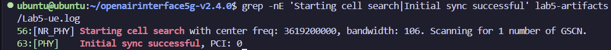
> UE synchronization succeeded: Yes (Lab5-ue.log:63, Initial sync successful). PCI = 0. The UE started cell search at 3619.2 MHz with 106 PRBs (line 56). After initial synchronization, the UE is aligned in time and frequency with the cell and knows its PCI, so it can decode the PBCH to read the MIB, then find and decode SIB1, which are the next steps toward Random Access.

#### Step 2: Find MIB and SIB1 — 8 points

In Wireshark, enter:

```text
nr-rrc
```

Find one `MIB` packet and one `SIB1` packet. Record the frame number of each and provide screenshots.

MIB and SIB1 are repeatedly broadcast system-information messages. The UE must obtain the common configuration before it can continue the access procedure. Briefly explain the purpose of MIB and SIB1 for UE access.

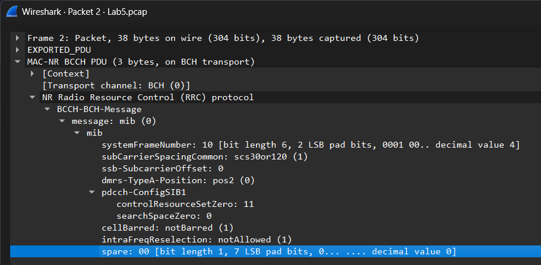
> MIB: frame 2. The MIB, carried on BCH/PBCH, gives the minimum information needed to find SIB1: the system frame number, subcarrier spacing (scs30), and pdcch-ConfigSIB1 (controlResourceSetZero = 11, searchSpaceZero = 0), which tells the UE where to monitor the PDCCH that schedules SIB1. cellBarred = notBarred means the UE is allowed to access this cell.

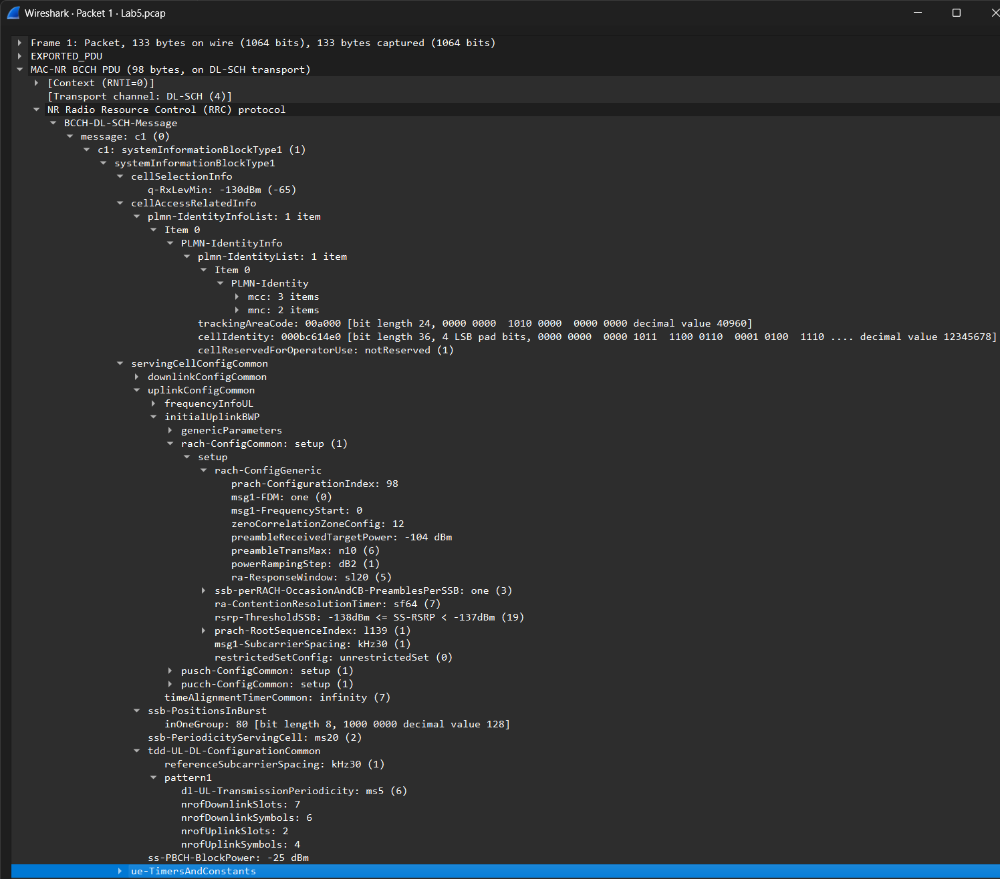
> SIB1 (frame 1) provides cell access information (PLMN 208/95, TAC 0x00a000, cell identity 12345678) and the common uplink configuration. In particular, rach-ConfigCommon tells the UE when and where it may send the PRACH preamble (prach-ConfigurationIndex 98, msg1-FDM one, msg1-FrequencyStart 0), at which power (target −104 dBm, 2 dB ramping, up to 10 attempts), and how long to wait for the RAR (ra-ResponseWindow 20 slots) and for contention resolution (sf64). Without SIB1, the UE could not start Random Access.

#### Step 3: Find Msg1 PRACH — 8 points

Run the following command on the UE log:

```bash
grep -nE 'PRACH' lab5-artifacts/Lab5-ue.log
```

Record the Msg1 log line number. From the line that shows the actual PRACH transmission, find:

```text
Msg1 log line = 81
frame.slot = 553.19
preambleIndex = 16
```

Next, return to Wireshark. Clear the display filter, press `Cmd/Ctrl + F`, choose **Packet details** as the search scope, and search for:

```text
RACH Preamble chosen
```

After locating the PRACH event recorded by the gNB tracer, record:

```text
RAPID = 16 (frame 489)
```

This packet is displayed as `MAC-LTE RACH Preamble chosen`; it is the OAI tracer MAC-event format.

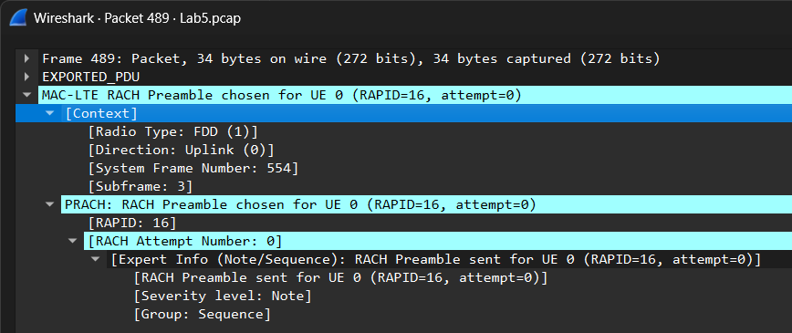
> Frame 489: the gNB-side tracer event for Msg1. RAPID = 16 and attempt = 0 match the UE log (preambleIndex = 16 at frame.slot 553.19), confirming that the gNB received the UE's preamble on the first try.

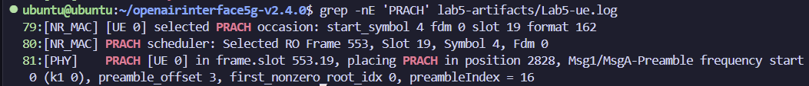
> Lines 79–80 show the UE selecting the PRACH occasion (Frame 553, Slot 19, Symbol 4); line 81 shows the actual Msg1 transmission at frame.slot 553.19 with preambleIndex 16.


Submit one UE-log screenshot and one Wireshark screenshot. Briefly answer:

1. Which Random Access message is this PRACH transmission?
> Ans : It is Msg1, the PRACH preamble, the first message of the 4-step Random Access procedure. The UE sends it on a PRACH occasion configured by SIB1, before it has any UE-specific uplink grant.
2. At which `frame.slot` and with which `preambleIndex` does the UE log show transmission?
> Ans : At frame.slot 553.19 with preambleIndex 16 (Lab5-ue.log:81). Lines 79–80 show that the UE first selected this PRACH occasion (Frame 553, Slot 19, Symbol 4), and slot 19 falls in the uplink part of the TDD pattern broadcast in SIB1.
3. Does the Wireshark `RAPID` match the UE-log `preambleIndex`? What does this show?
> Ans : Yes. The gNB tracer recorded RACH Preamble chosen for UE 0 (RAPID=16, attempt=0) in frame 489, which matches the UE's preambleIndex 16. This shows that the gNB detected exactly the preamble the UE transmitted, on the first attempt (attempt=0), so no preamble retransmission or power ramping was needed.

#### Step 4: Find Msg2 RAR in Wireshark — 11 points

Return to Wireshark and clear the display filter. Press `Cmd/Ctrl + F`, choose **Packet details** as the search scope, and search for `RAR` or `Random Access Response`. After locating the packet, record its frame number and find the following values in `MAC-NR RAR`:

```text
Frame number = 490
RAPID = 16
Temporary C-RNTI = 0xf21e (61982)
```

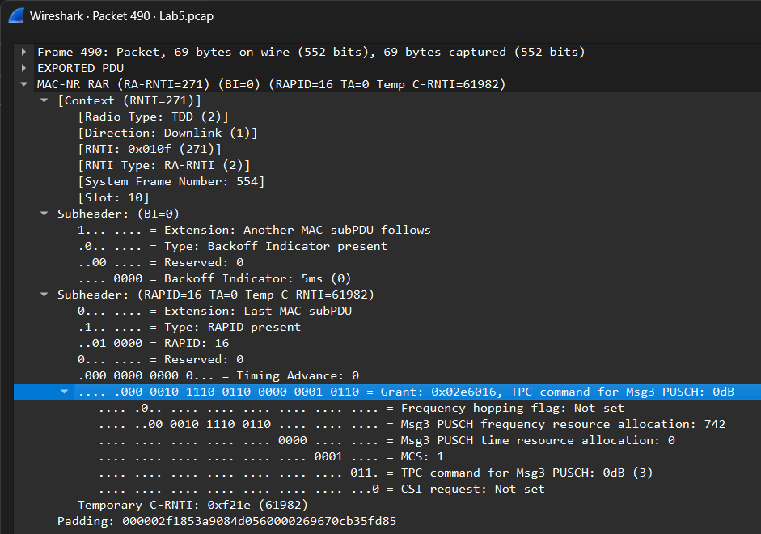
> Frame 490 is Msg2, the Random Access Response, addressed to RA-RNTI 271. Its MAC subPDU carries RAPID = 16, which matches the UE's Msg1 preambleIndex and the gNB's PRACH event (frame 489), so this response is meant for our UE. It assigns Temporary C-RNTI 0xf21e (61982), a Timing Advance of 0 (no propagation delay in RFsimulator), and an uplink grant (MCS 1, TPC 0 dB) that the UE will use to send Msg3. The RA-RNTI matches the Msg1 occasion (1 + 4 + 14 × 19 = 271), and the RAR was sent at SFN 554, slot 10, 11 slots after Msg1 and within the 20-slot ra-ResponseWindow configured in SIB1.

### Task 2: Complete Random Access and RRC Connection Setup — 40 points

Complete the following steps in order. For each message, provide a screenshot and record the requested frame number, fields, and brief explanation.

#### Step 1: Find RRCSetupRequest — 10 points

In Wireshark, use:

```text
nr-rrc.rrcSetupRequest_element
```

Expand `UL-CCCH-Message → rrcSetupRequest` and find:

```text
Frame number = 491
Context RNTI = 0xf21e (61982)
```

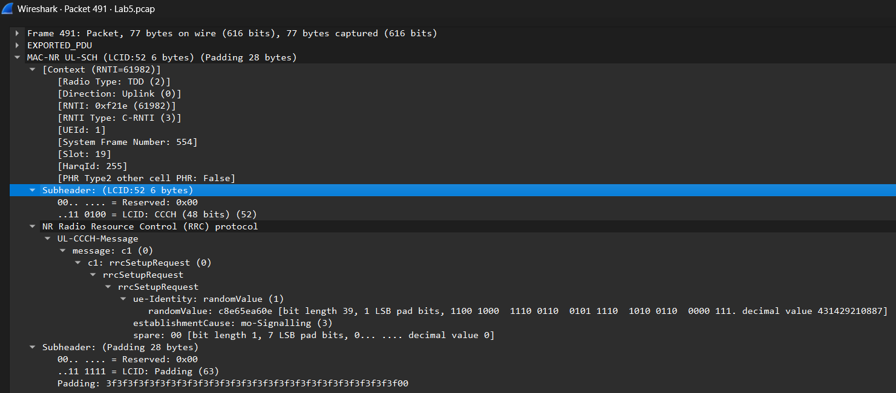
> Frame 491 is Msg3, sent on MAC-NR UL-SCH (PUSCH) at SFN 554, slot 19, using the grant from the RAR. The MAC context uses RNTI 0xf21e, the Temporary C-RNTI from frame 490. The 6-byte CCCH SDU (LCID 52) contains an RRCSetupRequest with a 39-bit random UE identity (c8e65ea60e) and establishmentCause mo-Signalling.

Briefly answer:

1. Does the `Context RNTI` match the `Temporary C-RNTI` in the Task 1 / Step 4 RAR? What does this show?
> Ans : Yes. The Context RNTI of frame 491 is 0xf21e (61982), the same as the Temporary C-RNTI assigned in the RAR (frame 490). This shows that the UE received the RAR addressed to its preamble (RAPID 16) and used the uplink grant and the Temporary C-RNTI given there to send Msg3, so the gNB can link this RRCSetupRequest to the same Random Access attempt.
2. Can you claim that the RRC connection has been established after seeing only `RRCSetupRequest`? Why or why not?
> Ans : No. RRCSetupRequest (Msg3) is only the UE's request, carrying a random 39-bit identity (c8e65ea60e) and the cause mo-Signalling. At this point, contention is not yet resolved: another UE could have chosen the same preamble and sent its own Msg3 on the same grant. The UE must still receive Msg4 (RRCSetup with the Contention Resolution identity matching its Msg3) and send RRCSetupComplete before it enters RRC_CONNECTED.

#### Step 2: Find RRCSetup — 10 points

Clear the previous filter and enter:

```text
nr-rrc.rrcSetup_element
```

Expand `DL-CCCH-Message → rrcSetup` and find:

```text
Frame number = 492
Context RNTI = 0xf21e (61982)
rrc-TransactionIdentifier = 1
```

Check whether `Contention Resolution` also appears in the packet.

> Contention Resolution present: Yes (UE Contention Resolution Identity = 1c8e65ea60e6)

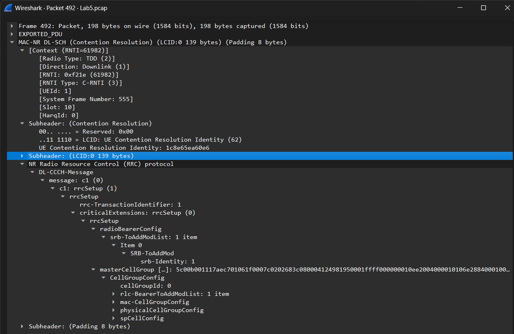
> Frame 492 is Msg4, sent on MAC-NR DL-SCH to RNTI 0xf21e at SFN 555, slot 10. It contains the UE Contention Resolution Identity (1c8e65ea60e6), which echoes the Msg3 CCCH SDU including the random identity c8e65ea60e, and an RRCSetup with rrc-TransactionIdentifier 1 that adds SRB1 and the master cell group configuration.

Below the screenshot, briefly answer:

1. Which message is this in four-step Random Access?
> Ans : It is Msg4. Frame 492 is a MAC-NR DL-SCH PDU sent to RNTI 0xf21e at SFN 555, slot 10. It carries the UE Contention Resolution Identity MAC CE together with the RRCSetup message on DL-CCCH.
2. What does it mean that `Contention Resolution` and `RRCSetup` appear in the same downlink message?
> Ans : It means Msg4 does two jobs at once. The MAC layer resolves contention: the UE Contention Resolution Identity (1c8e65ea60e6) is an exact copy of the 6-byte CCCH SDU the UE sent in Msg3, which contains its random identity c8e65ea60e, so the UE knows that the gNB accepted its Msg3 and not another UE's; the Temporary C-RNTI 0xf21e then becomes its C-RNTI. The RRC layer, in the same transport block, answers the RRCSetupRequest with RRCSetup (rrc-TransactionIdentifier 1), which establishes SRB1 and provides the UE's dedicated cell group configuration. Random Access is completed at this point, and the UE can apply the configuration and reply with RRCSetupComplete.

#### Step 3: Find RRCSetupComplete — 12 points

Clear the previous filter and enter:

```text
nr-rrc.rrcSetupComplete_element
```

Select the packet and first verify that `MAC-NR UL-SCH` appears at the top. Expand:

```text
RLC-NR → PDCP-NR → NR Radio Resource Control (RRC) protocol
  → UL-DCCH-Message → message: c1
```

Expand `message: c1` further and confirm that it contains `rrcSetupComplete`. Record:

```text
Frame number = 498
Context RNTI = 0xf21e (61982)
rrc-TransactionIdentifier = 1
```

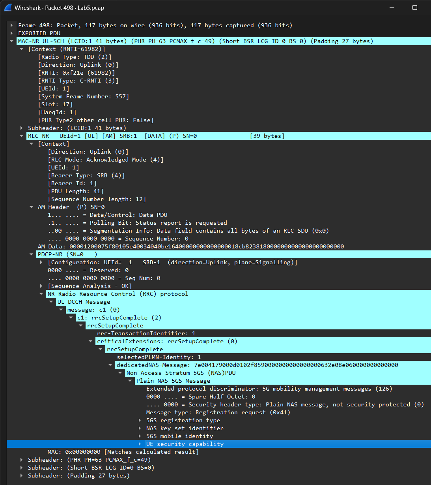
> Frame 498 is RRCSetupComplete, sent on MAC-NR UL-SCH with RNTI 0xf21e at SFN 557, slot 17. Unlike Msg3, it travels on SRB1 (LCID 1) through RLC AM (SN 0) and PDCP (SN 0) as a UL-DCCH message, showing that the SRB1 configured by RRCSetup is now in use. Its rrc-TransactionIdentifier (1) matches the RRCSetup in frame 492, and it carries the NAS Registration Request in dedicatedNAS-Message, which is where radio access hands over to 5GC registration.

Below the screenshot, briefly answer:

1. Does the `Context RNTI` still match the `Temporary C-RNTI` in the RAR?
> Ans : Yes. Frame 498 is addressed with RNTI 0xf21e (61982), the same value assigned as Temporary C-RNTI in the RAR (frame 490) and used in Msg3 (frame 491) and Msg4 (frame 492). After contention resolution in Msg4, this value became the UE's C-RNTI, so the same UE is identified consistently from RAR to RRCSetupComplete.
2. Does the `rrc-TransactionIdentifier` match the `RRCSetup` in Step 2? What is the purpose of this comparison?
> Ans : Yes. Both RRCSetup (frame 492) and RRCSetupComplete (frame 498) carry rrc-TransactionIdentifier 1. The transaction identifier links a response to the request it answers, so this match proves that frame 498 completes exactly the RRCSetup procedure started in frame 492, not some other RRC transaction.

#### Step 4: Confirm the Final Random Access and RRC Connection Result — 8 points

Run the following command on the UE log:

```bash
grep -nE '4-Step RA procedure succeeded|Received NR_RRCSetup|RRCSetupComplete|State = NR_RRC_CONNECTED' \
  lab5-artifacts/Lab5-ue.log
```

From the output, record:

```text
4-Step RA procedure succeeded: line 87
Received NR_RRCSetup: line 88
State = NR_RRC_CONNECTED: line 90
Generating RRCSetupComplete: line 93
```

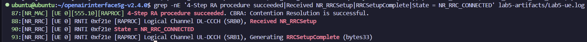

> UE log lines 87–93 show the end of the access procedure for RNTI 0xf21e: contention-based RA succeeds at [555.10], matching Msg4 in frame 492; the UE then receives RRCSetup on SRB0, enters NR_RRC_CONNECTED, and generates RRCSetupComplete on SRB1.

Submit a screenshot of this log output and briefly answer:

1. In log order, what are the three events from successful Random Access to generating `RRCSetupComplete`?

> Ans : (1) Line 87: 4-Step RA procedure succeeded. CBRA: Contention Resolution is successful at [555.10], the same SFN/slot as Msg4 (frame 492). (2) Line 88: Received NR_RRCSetup on DL-CCCH (SRB0) for RNTI 0xf21e. (3) Line 90: State = NR_RRC_CONNECTED. Then, at line 93, the UE generates RRCSetupComplete on UL-DCCH (SRB1). The UE enters RRC_CONNECTED when it applies the received RRCSetup, before it sends RRCSetupComplete, which matches the order specified in 3GPP TS 38.331.
2. What do `4-Step RA procedure succeeded` and `State = NR_RRC_CONNECTED` each prove?

> Ans : 4-Step RA procedure succeeded proves that Msg1–Msg4 all completed and that contention-based random access (CBRA) was resolved in the UE's favor: the Contention Resolution Identity in Msg4 matched its Msg3, so the Temporary C-RNTI 0xf21e became its C-RNTI. State = NR_RRC_CONNECTED proves that the RRC connection is established: the UE has applied the RRCSetup configuration, SRB1 is active, and the gNB holds a UE context. Neither proves 5GC registration, which only starts with the NAS Registration Request carried in RRCSetupComplete.

### Task 3: Draw an Initial Access MSC Diagram — 25 points

Using the log and Wireshark evidence found in Tasks 1 and 2, draw your own Message Sequence Chart (MSC). It must include two vertical lifelines, `UE` and `gNB`, and the following six messages: MIB/SIB1, Msg1, Msg2, Msg3, Msg4, and `RRCSetupComplete`.

Determine and draw the correct order and direction of the messages yourself. Add a one-sentence purpose next to each arrow.

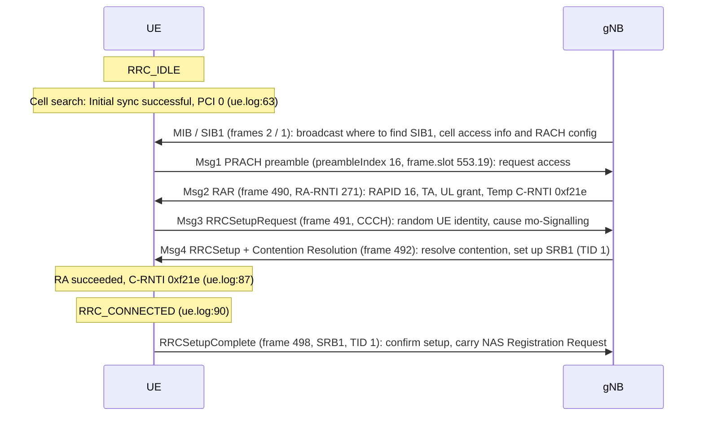

| Item | Points |
|---|---:|
| UE and gNB lifelines, with the two UE states identified | 5 |
| Complete message order: MIB/SIB1, Msg1, Msg2, Msg3, Msg4, RRCSetupComplete | 12 |
| Correct direction for every message arrow | 5 |
| Reasonable brief purpose for every major stage | 3 |
| **Task 3 subtotal** | **25** |

| Item | Points |
|---|---:|
| Task 1: Initial Access evidence timeline | 35 |
| Task 2: Key-message analysis | 40 |
| Task 3: Initial Access MSC diagram | 25 |
| **Total** | **100** |

## 7. Optional: Reproduce the Log and PCAP Files

This section is not required for the assignment. If you want to generate the same kind of evidence using your own OAI run, follow these steps in an OAI/5GC environment that was already set up in an earlier class.

The commands below assume that you are currently in the `openairinterface5g` repository root. Use three terminals and first create a directory for the artifacts:

```bash
mkdir -p lab5-artifacts
```

### Terminal A: Start the gNB and Wait for the Tracer

```bash
cd cmake_targets/ran_build/build

sudo -E env RFSIMULATOR=server ./nr-softmodem \
  -O ../../../ci-scripts/conf_files/gnb.sa.band78.106prb.rfsim.conf \
  --rfsim --T_stdout 2 \
  2>&1 | tee ../../../lab5-artifacts/Lab5-gnb.log
```

### Terminal B: Record the gNB MAC/RRC Trace

```bash
cd cmake_targets/ran_build/build

./common/utils/T/tracer/record \
  -d ../../../common/utils/T/T_messages.txt \
  -o ../../../lab5-artifacts/Lab5-gnb-wireshark.raw \
  -on WIRESHARK
```

The gNB in Terminal A continues after the tracer connects.

### Terminal C: Start the UE and Save the UE Log

```bash
cd cmake_targets/ran_build/build

sudo -E RFSIMULATOR=127.0.0.1 ./nr-uesoftmodem \
  -O ../../../targets/PROJECTS/GENERIC-NR-5GC/CONF/ue.conf \
  --rfsim -r 106 --numerology 1 --band 78 -C 3619200000 \
  2>&1 | tee ../../../lab5-artifacts/Lab5-ue.log
```

After `State = NR_RRC_CONNECTED` appears, wait a few seconds, then stop the terminals in this order: recorder in Terminal B, UE in Terminal C, and gNB in Terminal A.

### Convert the Trace to a Wireshark PCAP

```bash
cd cmake_targets/ran_build/build

./common/utils/T/tracer/macpdu2wireshark \
  -d ../../../common/utils/T/T_messages.txt \
  -i ../../../lab5-artifacts/Lab5-gnb-wireshark.raw \
  -to-file ../../../lab5-artifacts/Lab5.pcap
```

You should obtain:

```text
lab5-artifacts/Lab5-ue.log
lab5-artifacts/Lab5-gnb.log
lab5-artifacts/Lab5.pcap
```
